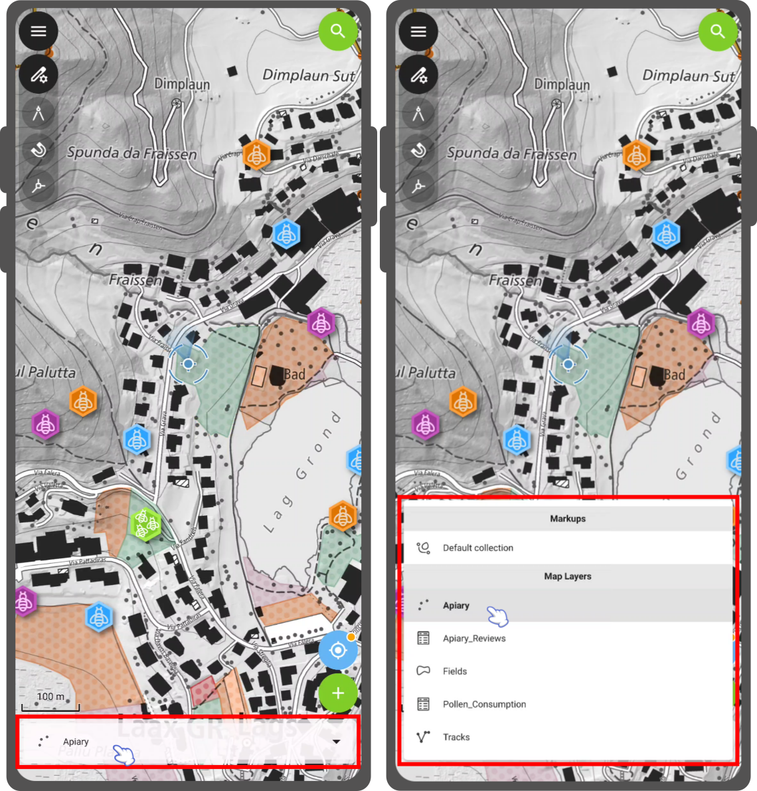
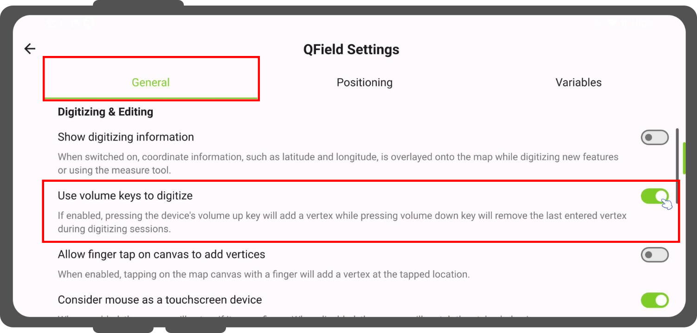
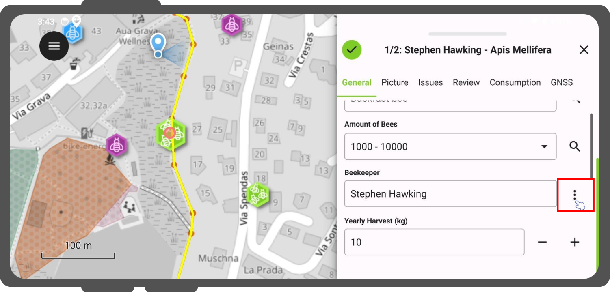
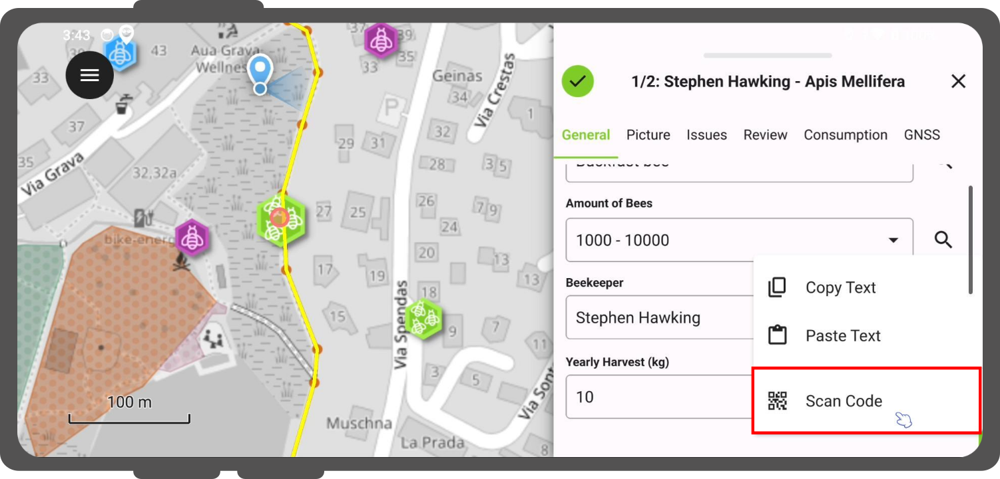
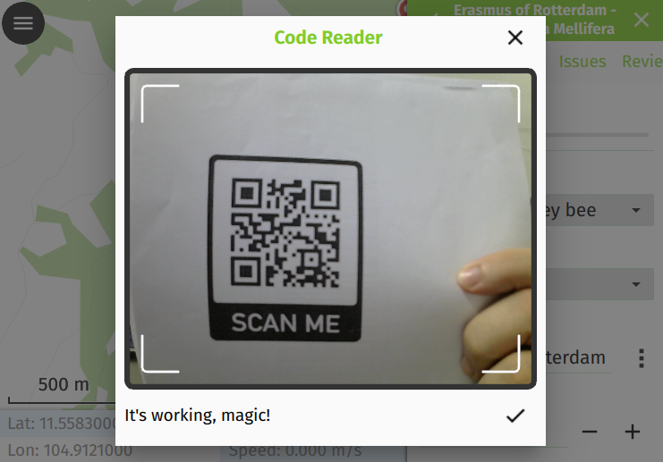
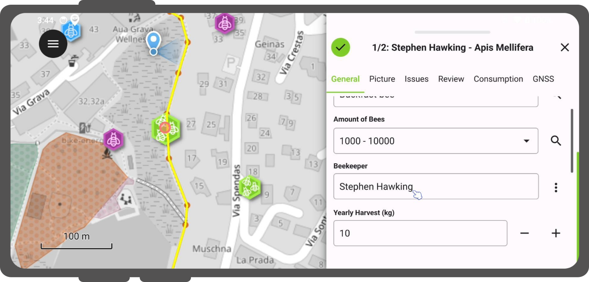
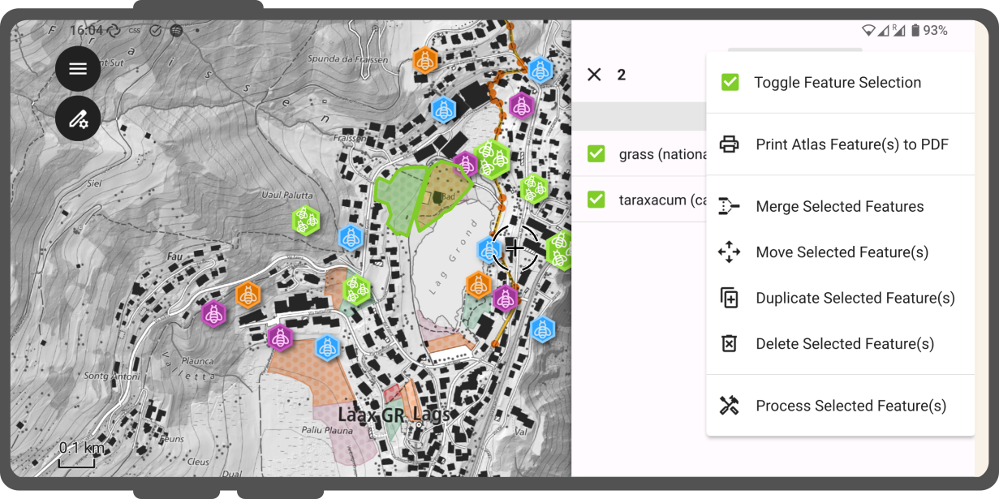
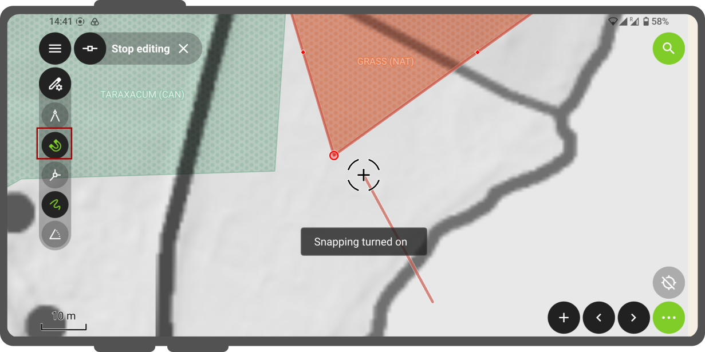
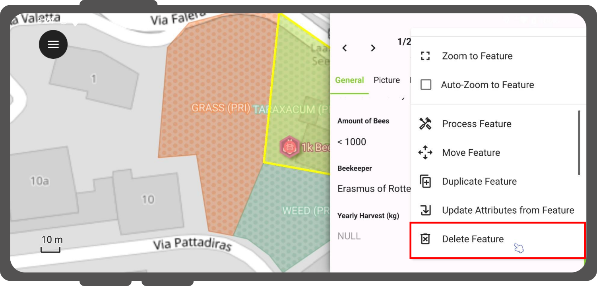
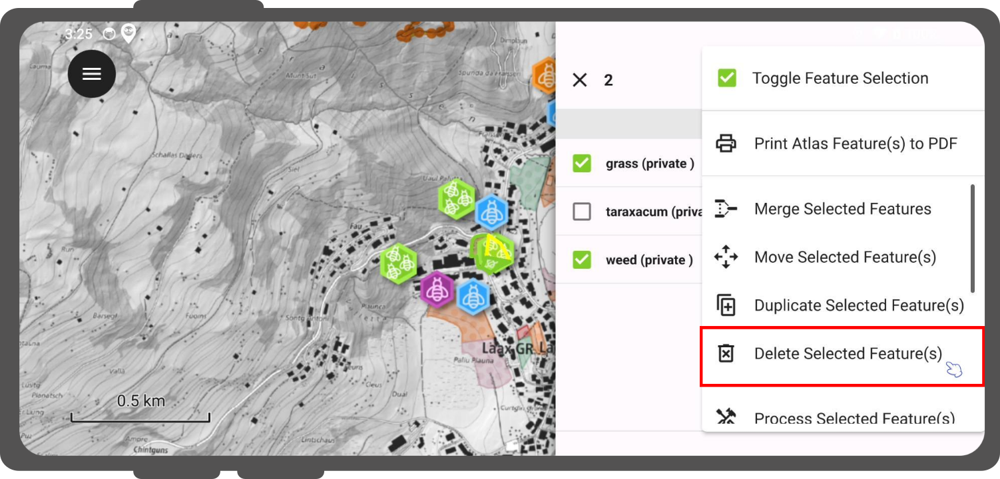

# Digitize and Edit

QField allows you to digitize, edit, and delete point, line, and polygon features along with their attributes in the field.
To modify only existing attribute values, stay in **Browse Mode**.
To add new features or modify existing geometries, switch to **Digitize Mode**.

## Digitizing Mode and Active Layer Bar

When you switch QField to **Digitize Mode**, a **Digitizing information bar** appears at the bottom of the map canvas:

- **Active Layer Combobox:** Displays the active layer where your newly digitized features will be saved. Tap on the combobox to quickly switch to a different editable layer without opening the **Side Dashboard**.

!

!!! Workflow
    1. Open the **Side Dashboard** and tap the pencil icon (:material-pen:) to switch to **Digitize Mode**.
    2. Check that the **Digitizing information bar** displays the layer you want to add features to.
    3. (Optional) Tap the combobox in the information bar to switch to another editable layer before digitizing.

## Adding New Objects

### Adding Point Objects

!!! Workflow
    1. Move the map crosshair to the target location where you want to add the point.
    2. Tap :material-plus-circle: in the lower-right corner to create the point feature.
        (Optional) Enable **Lock to position** in the GNSS menu to snap the crosshair directly to your current GNSS location.

        !

    3. (Optional) Tap the red **X** to cancel creating the feature.

### Adding Line or Polygon Objects

!!! Workflow
    1. Move the map crosshair to the starting position of the line or polygon.
    2. Tap **:material-plus-circle:** in the lower-right corner to place the first vertex.
    3. Pan the map crosshair to each subsequent vertex position and tap **:material-plus-circle:** to add vertices.
    4. (Optional) Tap **:material-minus:** to undo the last added vertex.
    5. Tap **:material-check:** to finish digitizing the geometry (requires at least 2 vertices for lines and 3 vertices for polygons).
    6. (Optional) Tap the red **X** to cancel creating the feature.

    

### Additional Editing Settings

You can configure hardware and touch shortcuts to speed up your field data collection:

- **Use volume keys to digitize:** Use physical device volume buttons to add and remove vertices without tapping the screen *(Android only)*.
- **Allow finger tap on canvas to add vertices:** Tap directly anywhere on the map canvas to place vertices instead of using the crosshair button.

!!! Workflow
    1. Open the **Side Dashboard**.
    2. Tap the **3-dotted menu (⋮)** at the top right and select **Settings > General**.
    3. Toggle **Use volume keys to digitize** or **Allow finger tap on canvas to add vertices**.

    !

### Attribute Form

After finishing a geometry, the feature attribute form opens so you can populate attribute fields.

#### Add Values Using QR Codes and Barcodes

!!! Workflow
    1. Open the feature attribute form.
    2. Tap the **3-dotted menu (⋮)** next to the target attribute field.
    3. Choose from the available field actions:
        - **Copy**
        - **Paste**
        - **Scan Code:** Reads QR codes, barcodes, and NFC text tags.

        !

    4. Tap **Scan Code**.

        !

    5. Scan the code or NFC tag and tap :material-check: to insert the value into the field.

        !
        !

!!! Note
    Both the camera code scanner and NFC tag detector are enabled by default when opening the Code Reader.
    You can disable either of these features inside the reader dialog to conserve device battery.

#### Remember Attribute Values

To reuse attribute values across consecutive new features, tap the pin icon (:material-pin:) next to any field so QField remembers the last entered value.

!!! Note
    Remembered attribute values apply only when **adding** new features.

## Editing Existing Geometries

!!! Workflow
    1. Switch to **Digitize Mode** by opening the **Side Dashboard** and tapping :material-pen:.
    2. Tap the existing feature on the map canvas to identify it.
    3. Open the feature form and tap the **Edit Geometry** button.
    4. Select a geometry editing tool from the bottom toolbar:
        - **Vertex Editor Tool:** Move, add, or delete individual vertices on existing geometries.
        - **Split Tool:** Split a line or polygon feature into two separate features inheriting the original attributes.
        - **Reshape Tool:** Modify line or polygon boundaries by drawing a reshaping line across or along the feature.
        - **Eraser Tool:** Erase parts of a polygon or carve holes inside an existing geometry.
        - **Ring Tool:** Create an interior ring (donut hole) inside a polygon, with an option to fill the hole with a new polygon feature.

### Editor Tool

### Reshape Tool

### Split Tool

### Eraser Tool

### Ring Tool

## Merging Features

Combine multiple selected features on the same layer into a single merged geometry.

!!! Workflow
    1. Tap a feature on the map canvas to identify it.
    2. Long-press the feature in the identification list to enter multi-selection mode.
    3. Tap additional features to add them to your selection.
    4. Tap the **3-dotted menu (⋮)** in the top-right corner and select **Merge Selected Features**.

    !

## Freehand Digitizing

When using a stylus or mouse on line or polygon layers, QField supports freehand drawing to create or reshape geometries smoothly.

Freehand digitizing is toggled via the freehand toolbar button, which appears automatically in **Digitize Mode** when a stylus pen or mouse hovers over the map canvas while a line or polygon layer is active.

<!-- markdown-link-check-disable-line -->

## Snapping

Enable snapping in **Digitize Mode** to align new vertices precisely to existing feature vertices or segments.

!!! Workflow
    1. Switch to **Digitize Mode** to reveal the expandable digitizing options button (:material-pen:) in the top-left corner below the **Side Dashboard** button.
    2. Tap :material-pen: and toggle the snapping icon (:material-horseshoe:) before placing your first vertex or editing a geometry.

    !

!!! Note
    Snapping tolerances and target layers follow the snapping configuration defined in your QGIS project.
    Read more in the [Project Snapping Documentation](../../how-to/data-collection/digitize.md#snapping).

## Snap to Common Angle

Constrain line and polygon segments to predefined angles while digitizing.

!!! Workflow
    1. Switch to **Digitize Mode** and start adding a line or polygon feature (:material-plus-circle:).
    2. Tap the expandable digitizing options button (:material-pen:) in the top-left corner and long-press the **Angle Symbol**.
    3. Select a predefined angle (`10°`, `15°`, `30°`, `45°`, or `90°`) and tap it to activate angle snapping.
    QField maintains the angle lock relative to the previous segment across subsequent vertices.

    

## Topological Editing

When topological editing is enabled in your QGIS project, moving shared vertices or boundaries automatically updates adjacent connected features to prevent gaps and overlaps.

The specific topological editing rules must be set in the [QGIS project](../../how-to/data-collection/digitize.md#topological-editing).

## Editing Multiple Attributes
:material-tablet: Fieldwork

Update attribute values across multiple features simultaneously.

!!! Workflow
    1. Identify features on the map canvas and long-press an entry to enter multi-selection mode.
    2. Select all additional features you want to update.
    3. Open the multi-edit attribute form, modify the desired fields, and tap :material-check: to apply changes to all selected features.

    

## Copy, Cut, and Paste
:material-tablet: Fieldwork

Copy or cut features and paste them into the same layer or a different target layer regardless of geometry type.
QField automatically maps values between fields with matching attribute names while leaving unmatched fields blank.

## Delete Features
:material-tablet: Fieldwork

!!! Workflow
    1. Select one or more features by opening a feature attribute form or using multi-selection in the identification list.
    2. Tap the three-dotted menu *(⋮)*.
    3. Select **Delete feature(s)** and confirm deletion.

    !
    !

## Geofencing
:material-tablet: Fieldwork

QField includes built-in geofencing alerts that notify you when your GNSS position enters or exits designated polygon areas configured via the QFieldSync plugin in QGIS.

When a geofencing alert triggers, a glowing red indicator appears in the bottom-right corner of the screen (accompanied by device vibration if supported) until you leave the restricted zone.

If your project is configured to prohibit digitizing inside geofenced zones, QField automatically hides the digitizing toolbar while inside the restricted area to prevent accidental data entry.
