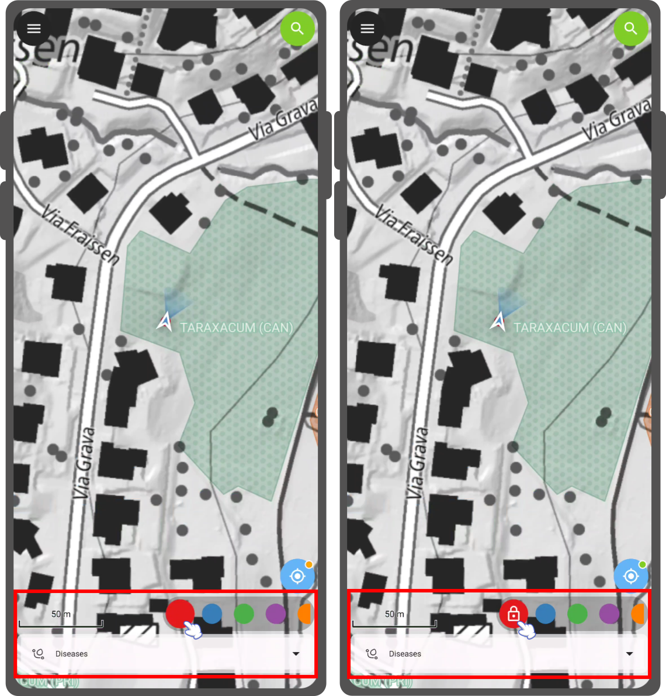

# Markups

Markups allow you to quickly sketch freehand notes, points of interest, lines, and highlighted areas directly on the map canvas without modifying your project's underlying GIS layers or schemas.

Each markup item stores a geometry (point, line, or polygon), a color, and an optional text description.
Markups are organized into **Markup Collections** and automatically saved as standard GeoJSON files inside your project directory.

## Managing Markup Collections

When you open a project or dataset in QField, a **Default collection** is automatically available in the **Markups** section of the **Side Dashboard** (visible whenever at least one markup item exists or when **Digitize Mode** is active).

### Creating a New Collection

Organize field notes by theme, task, or survey day by creating multiple markup collections:

!!! Workflow
    1. Open the **Side Dashboard** and switch to **Digitize Mode** (:material-pen:).
    2. In the **Markups** section above the layer legend, tap **Create New Collection**.
    3. Enter a name for your collection and tap **OK**.
    4. The new collection becomes the active target for drawing markups.

!

### Collection Visibility and Properties

Each collection in the **Markups** list includes an eye icon on the left to toggle its visibility on the map canvas.

Long-press (or double-tap) a collection name in the **Markups** list to open its **Collection Properties** dialog, which provides the following actions:

- **Show on map:** Toggles whether items in the collection are rendered on the map canvas.
- **Zoom to collection:** Centers and zooms the map canvas to fit all markup items in the collection.
- **Show features list:** Opens the feature list displaying all markup items belonging to the collection.
- **Share collection:** Exports the collection as a `.geojson` file and opens your device's share menu to send it via email, messaging apps, or cloud storage.

!

## Drawing Markups on the Map

Markups are drawn freehand on the map canvas using your finger, a stylus, or a mouse.

!!! Workflow
    1. Open the **Side Dashboard** and tap the pencil icon (:material-pen:) to enter **Digitize Mode**.
    2. Select a markup collection as your active target using either method:
        - Tap a collection under the **Markups** section in the **Side Dashboard**.
        - Tap the active layer combobox in the **Digitizing information bar** at the bottom of the screen and select a collection under the **Markups** group.
    3. In the **Markup Toolbar** at the bottom right of the canvas, tap one of the five color swatches (red, blue, green, purple, or orange) to activate drawing.
    4. Tap or draw directly on the map canvas to create a markup item.

### Color Selection and Locking

The **Markup Toolbar** supports two drawing modes depending on how you tap a color swatch:

- **Single-Item Mode (One Tap):** Tap a color swatch once to enlarge it and draw a single markup item. As soon as you lift your finger or stylus, the color automatically deselects so you can pan and zoom the map normally without accidental marks.
- **Continuous Drawing Mode (Two Taps):** Tap an active color swatch a second time to **lock** it (indicated by a lock icon inside the swatch). While locked, every tap or stroke on the canvas creates a new markup item in that color until you tap the swatch a third time to unlock and exit drawing mode.

!

### Automatic Shape Recognition

QField automatically smooths freehand strokes and classifies each markup into one of three geometry types based on your gesture:

- **Point:** Tap once on the map canvas to place a circular point marker.
- **Line:** Draw an open stroke across the map to create a smoothed polyline.
- **Polygon:** Draw a closed loop where the end of your stroke finishes near the starting point to automatically close and fill a polygon.

## Inspecting, Editing, and Moving Markups

Markup items behave like map features and can be inspected and updated after creation:

!!! Workflow
    1. Tap any markup item on the map canvas (or select **Show features list** from its collection properties) to open the feature identification panel.
    2. Tap the markup item to view its details, or tap the **Edit** (:material-pen:) button to modify its attributes:
        - **Color:** Change the item's display color.
        - **Description:** Add or edit multi-line notes describing the annotation.

        !

    3. To reposition a markup item, select it in the identification list, open the **3-dotted menu (⋮)**, and choose **Move Selected Feature(s)** (or **Delete Feature(s)** to remove it).

        !

!!! Note
    Because markups are freehand annotations rather than structured GIS vector layers, vertex-by-vertex geometry editing, feature merging, and feature duplication are not available for markup items.

## Storage, Sharing, and Printing

- **File Storage Location:** Markup collections are stored automatically in WGS 84 (`EPSG:4326`) inside a `markups/` subfolder next to your project or dataset file (`<project_folder>/markups/`).
  - For **QFieldCloud** projects, collection files are prefixed with your QFieldCloud username so each collaborator's local markups remain separate.
  - For standalone **datasets**, collection files are prefixed with the dataset filename.
- **Opening in QGIS:** Because collections are saved as standard `.geojson` files, you can share a collection via **Share collection** (or copy it from the `markups/` folder) and drag and drop it directly into QGIS Desktop.
- **Print Layouts:** Any markup collections currently visible on the map canvas are automatically included when exporting a project print layout to PDF in QField.
