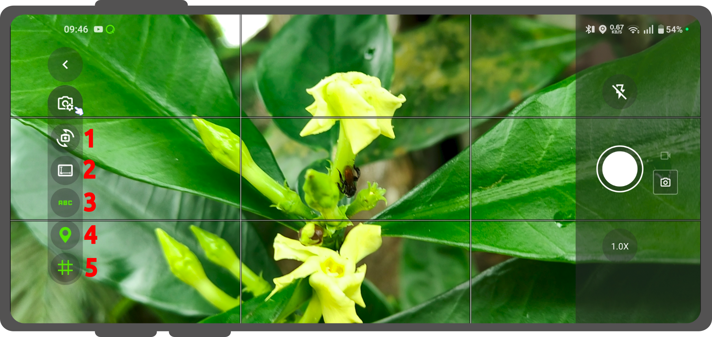
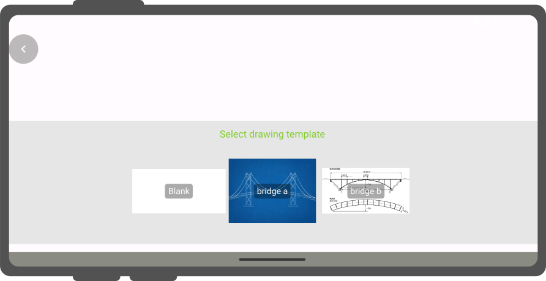

# Use attachment

You can take **photos**, **videos** and even record **sound clips** if your layer contains such a field.
You can also add **PDFs** or other **documents**.
!

## In-App Camera Interface

When taking pictures within an attachment widget inside QField, the built-in camera interface provides several live toggles and post-capture editing tools:

!

1. **Camera Switch:** Switch between the front-facing and rear-facing camera lenses on your device.
2. **Resolution & Aspect Ratio:** Adjust the photo resolution and frame dimensions to manage your file sizes and image layouts.
3. **Live Image Stamping:** You can add some customized title or information to your photo using this option.
    By default, the text adds the date, time, latitude, longitude, altitude, ground speed, and heading orientation in degrees
    (you can configure the [stamp with expressions](../../how-to/project-setup/pictures.md#image-stamping)).
4. **Location Metadata (EXIF):** Toggle whether geographic metadata is baked directly into the background of the image file structure itself.
5. **Composition Grid:** Displays a rule-of-thirds grid line layout on the screen to help frame, align, and capture better photos in the field.

### Photo Preview & Quick Editing
Once a photo is captured, a preview screen allows you to inspect and manually adjust the image before saving it to your project.
A floating toolbar above the capture button offers the following quick edits:

- **Rotate Counter-Clockwise:** Rotates the photo 90° to the left.
- **Mirror / Reflect:** Flips the photo horizontally.
- **Rotate Clockwise:** Rotates the photo 90° to the right.

Any rotation or reflection applied during preview is permanently baked into the final saved JPEG image alongside any active image stamps or EXIF metadata.

## Drawing and sketching

### Sketching

QField has an in-app drawing and sketching functionality enabling you to directly sketch over and annotate images captured while in the field as well as drawing on top of a blank canvas or over a template.

### Using templates

On top of annotating captured images, QField supports drawing from image templates.

!!! Workflow

    1. Open your attribute form.
    2. Direct to the photo field.
    3. Click on the the **3-dotted menu *(⋮)** next to the photo field.
    4. Select **Draw a sketch**
    !
    If you have pre-configured templates added to your projects they will show up here.
