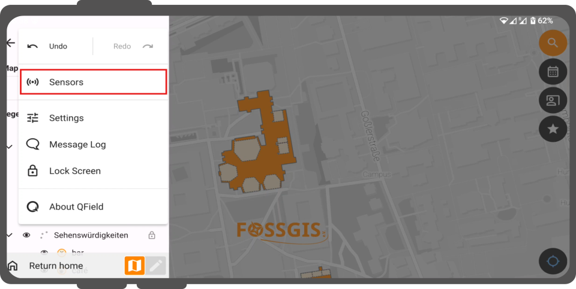
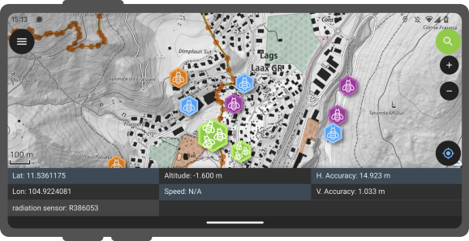
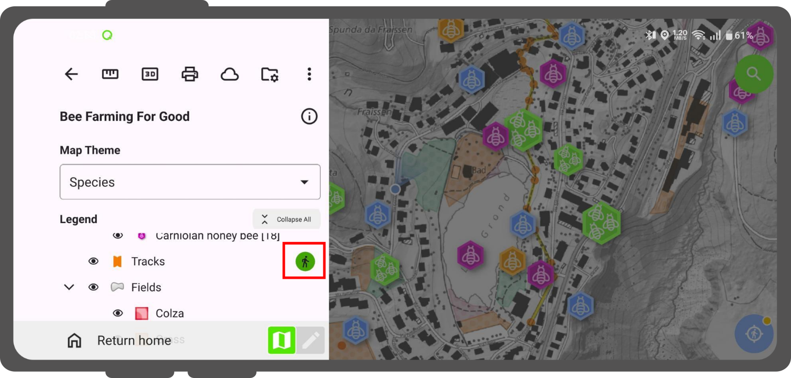

# Sensors

QField offers a range of sensor functionalities that allow you to passively collect sensor data in the background, display the collected data, and save it into newly-digitized feature attributes.

## Activating sensors

In QField, registered sensors are listed within the currently opened project file in a sub-menu that can be accessed via the **Side Dashboard**.

!!! Workflow

    1. Open the **Side Dashboard**
    2. Tap on the **3-dotted-menu** and select **Sensor**
    **Note:** This option will only appear if you have a sensor configured.
    See [here](../../how-to/advanced-how-tos/sensors.md) how to configure a sensor.

        !

    3. To toggle the passive collection of sensor data, simply click on a sensor name in the sub-menu.
     When active, a sensor icon will appear next to the sensor name, while when inactive, a dot icon will be shown.
     All active sensors that are collecting data will be listed in a sensors information table located at the bottom of QField's map canvas.

        !

## Sensor-Driven Tracking

If your project has the right configuration, you can track the sensor recordings in a point layer.
See [here](../../how-to/advanced-how-tos/sensors.md) how to configure the QGIS project, prior to the fieldwork.

!!! Workflow

    1. Open the **Side Dashboard** and long-press on the layer which you want to use for tracking.
    2. Tap **Setup tracking** and a new window will appear showing the configuration settings.

        !

    3. Choose the **Sensor data-requirement** option.
    4. Tap the **Start tracking** button to begin the tracking.
    5. Enter the attributes for  the feature(s) about to be created and tap the :material-check:.
    If your QGIS project was pre-configured, the recorded values of the sensor will be saved in the according field.
    Once a tracking session is set up, a badge :material-head: appears in the **Side Dashboard** next to the tracked layers.
    !
    6. Once finished open the **Side Dashboard** and long-press on the layer's tracking badge you want to stop.
    7. Tap **Stop tracking** to finish the session.

!
