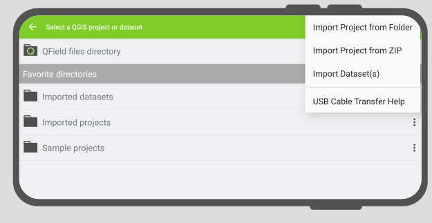
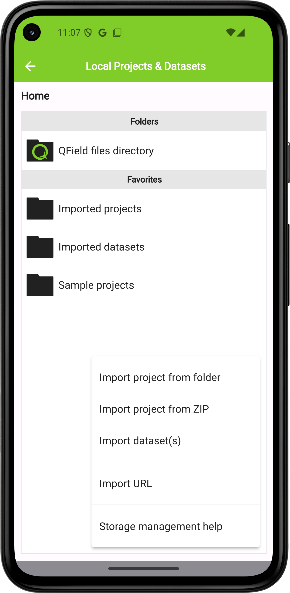
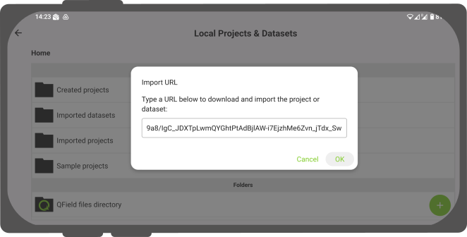
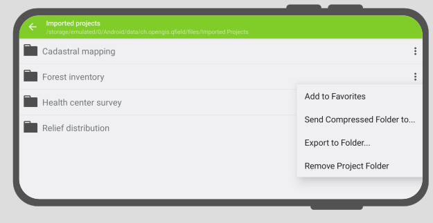
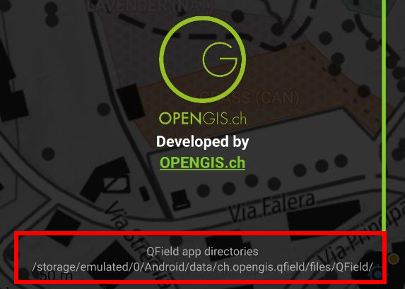

# QField storage management

On the QField home screen, you have two options to open a project.

- **QFieldCloud projects**: The first option is to [access a project stored on QFieldCloud](../../get-started/tutorials/get-started-qfc.md)
How to set up and work with QFieldCloud is explained in the next chapter.
- **Open local file**: The second option involves copying a working copy of the QGIS project file from a laptop or PC (the source device) to the phone or tablet (the target device).
On the target device, you can access and edit this local copy using QField and eventually copy the edited version back to the desktop or to an alternative cloud storage service.

There are various possibilities to import copies of project files and datasets from your desktop or a cloud storage for field-data collection.

## 1. Copying project over to the QField target device

On both the Android and iOS devices, installing QField creates a folder called QField, containing three folders; `Imported Datasets`, `Imported Projects` and `QField`.

!!! Workflow
    1. Package your QGIS project before transferring it to your mobile device:
        - **Using QFieldCloud:** Upload your project and datasets directly via QFieldSync.
        - **Manual Transfer:** Package your project using the [QFieldSync plugin](../../get-started/tutorials/get-started-qfs.md) in QGIS.
    2. Copy the packaged project folder into the `Imported Projects` directory on your device:
        - **Android:** `Android/data/ch.opengis.qfield/files/Imported Projects`
        - **iOS:** `On My iPhone/QField/Imported Projects`

### Android Transfer Methods

#### Transfer via USB-cable

Connect your Android device to your computer via USB and follow the [Android file transfer instructions](https://support.google.com/android/answer/9064445?hl=en-GB#zippy=%2Cwindows-computer).

On most devices, the QField storage path appears as `<drive>:/Android/data/ch.opengis.qfield/files/`. Place project folders inside `Imported Projects` and standalone datasets inside `Imported Datasets`. Field edits are saved directly to the files in these locations.

#### Google Drive and Cloud storage services

Using cloud storage provides a shared workspace between your desktop computer and mobile device.

!!! Workflow
    1. Package your QGIS project on your computer.
    2. Upload the packaged project folder to Google Drive.
    3. Download the project folder to your Android device and collect field data.
    4. Upload the modified project files back to Google Drive, replacing the older files.
    5. Download the updated project files back onto your computer.

!!! Note
    Create a dedicated folder in Google Drive for your QField projects and mirror that folder structure on your mobile device to keep project versions organized.

#### Bluetooth

Transfer project files wirelessly between your computer and Android device by [sharing files over Bluetooth](https://www.wikihow.com/Connect-Your-Android-Phone-to-a-Windows-PC-Using-Bluetooth).

### iOS Transfer methods

#### USB Cable

Because iOS restricts direct access to individual nested files inside app directories over USB, transfer the entire `Imported Projects` folder when syncing via cable:

!!! Workflow
    1. Copy the `Imported Projects` folder from your iOS device (iPhone or iPad) to your Mac or PC.
    2. Place your packaged QGIS project folder inside the copied `Imported Projects` folder.
    3. Copy the updated `Imported Projects` folder back to your iOS device, replacing the existing directory.

#### iCloud and sloud storage services

Use iCloud to [download and upload project files](https://support.apple.com/en-in/111764) between macOS/Windows and iOS.
iOS cannot open projects directly from external cloud folders you have to move downloaded projects into QField's local `Imported Projects` folder before opening them.

!!! Workflow
    1. Upload the packaged project from your computer to a folder on iCloud (for example, `QField Projects`).
    2. On your iOS device, download the project and move it into `On My iPhone/QField/Imported Projects`.
    3. Open the project in QField and complete your fieldwork.
    4. Upload the modified project back to iCloud Drive, replacing the previous version.
    5. Download the updated project onto your computer.

#### AirDrop

Exchange project files quickly between macOS and iOS devices using AirDrop:

!!! Workflow
    1. On your Mac, right-click the packaged project folder or archive and select **Share > AirDrop**, then choose your iOS device.
    2. On your iOS device, save the received files into the `Imported Projects` folder in the **Files** app.
    3. After fieldwork, share the modified project folder back to your Mac via AirDrop.

## 2. Importing Projects and Datasets

Beyond QFieldCloud, QField can import local and remote data through five options in the local file picker:

- **Import project from folder**   <!-- markdown-link-check-disable-line -->
- **Import compressed project**   <!-- markdown-link-check-disable-line -->
- **Import dataset(s)**   <!-- markdown-link-check-disable-line -->
- **Import from URL**
- **Import from WebDAV folder**

!

On **Android and iOS**, tap **Open local file** on the welcome screen, then tap the **Import (`+`)** button in the bottom-right corner to access all five import methods.
On **Windows, macOS, and Linux**, only **Import from URL** and **Import from WebDAV** are shown in the menu because local folders can be opened directly from your system file browser.

!

### Importing a project folder

Selecting **Import project from folder** prompts you to grant QField read access to a folder on your device storage, copying its contents into `Imported Projects`.
Re-importing a folder with the same name overwrites the existing copy in QField, allowing you to update local project configurations.

!!! Note
    Feature additions, geometry edits, and deletions are written to the copied project inside QField's `Imported Projects` folder—not to the original source folder selected during import.

### Importing a Compressed Project

Select **Import compressed project** to import a `.zip` archive containing a QGIS project. QField extracts the archive automatically into `Imported Projects`.

For an already opened **local project**, you can also update its files from a `.zip` archive by opening the project folder view (via the folder-with-gear icon in the **Side Dashboard**), tapping the action button in the bottom-right corner, and selecting **Update project from archive**.
**Note:** This option is disabled for QFieldCloud projects to preserve cloud synchronization integrity.

### Importing Individual Datasets

Select **Import dataset(s)** to pick one or more standalone files via your device's file picker. QField copies the selected files into `Imported Datasets`.

!!! Note
    When importing multi-file formats such as ESRI Shapefiles, select all required sidecar files together (`.shp`, `.shx`, `.dbf`, `.prj`, and `.cpg`).

### Importing from a URL

Select **Import from URL** and enter a direct web link to a dataset or `.zip` project archive. QField downloads the file and stores it in `Imported Projects` (if a `.qgs`/`.qgz` file exists inside the archive) or `Imported Datasets`.

!

## 3. Exporting Modified Projects and Datasets

After completing fieldwork, export modified projects and datasets from QField using one of the four methods:

- **Export to folder:** Copy a project folder or individual dataset to device storage or a scoped storage provider.
- **Compress and send project folder:** Package an entire project folder or subfolder into a `.zip` archive and share it via another app.
- **Send individual dataset:** Share a single modified dataset file directly via another app *(Android only)*.
- **USB cable transfer:** Copy files directly from `Imported Projects` or `Imported Datasets` on your device.

!

### Exporting a Project Folder or Individual Dataset

Select **Export to folder...** from the **3-dotted menu (⋮)** next to the project folder or dataset to copy the modified files to a chosen directory on your device.
This workflow integrates with third-party synchronization tools (such as [Syncthing](https://docs.syncthing.net/intro/getting-started.html)) and cloud storage providers supporting Android's Scoped Storage provider (such as Nextcloud).

!!! Note
    Exporting to a destination folder overwrites existing files with matching names.

### Sending a Compressed Project Folder

Select **Compress project and send to...** (or **Send compressed folder to**) to package a project folder or selected subfolder (such as a `DCIM` photo folder) into a `.zip` archive and send it via email, messaging apps, or cloud storage.

You can access this action from two locations:

- **Local File Browser:** Tap the **3-dotted menu (⋮)** next to the folder in `Imported Projects`.
- **Active Project Folder View:** Open any active local or QFieldCloud project, open the **Side Dashboard**, tap the project folder icon (folder with a gear), and tap the action button in the bottom-right corner.

### Sending an Individual Dataset (Android Only)

Tap the **3-dotted menu (⋮)** next to the dataset file and select **Send to...** to share the modified dataset directly through apps such as Gmail, Google Drive, Dropbox, or Nextcloud.

### Exporting Files or Backups from a QFieldCloud Project

Even when working with a QFieldCloud project, you can export the entire project folder as a compressed backup (or upload it to WebDAV) as well as export individual offline datasets and attachments directly from QField.
This is especially useful as an offline safety backup before synchronizing changes.

!!! Workflow
    1. Open your QFieldCloud project and reveal the **Side Dashboard**.
    2. Tap the **Project Folder** icon to open the project's root directory.

        !

    3. Choose whether to export the **entire project** or **individual files**:
        - **Export the Entire QFieldCloud Project:** Tap the floating action button (:material-plus:) in the bottom-right corner of the project folder view and select **Compress project and send to...**.
        This will allow you to either share a `.zip` archive of the whole project, the `data.gpkg` only or media attachments)
        Alternatively, you can also **Upload project to WebDAV** if you have this configured.

            !

        - **Export Individual Files or Folders:** Locate the target file (such as `data.gpkg`) or media folder (such as `DCIM`), tap the **3-dotted menu (⋮)** on the right, and choose **Send to...** or **Export to folder...**.

            !
            !

## 4. QField app directory

Beyond individual project folders, QField uses a centralized **App Directory** to store resources and configurations shared across all projects on a device, eliminating the need to duplicate basemaps, fonts, or credentials per project.

### Locating the Local App Directory

!!! Workflow
    1. Open any project in QField and reveal the **Side Dashboard** in the top-left corner.
    2. Tap the **3-dotted menu (⋮)** and select **About QField**.
    3. Scroll to the bottom of the dialog to view the local **App directories** paths for your device.

!

### Default App Directory Paths by Operating System

- **Android:** `Internal Storage/Android/data/ch.opengis.qfield/files/QField`
- **iOS:** `Files App > On My iPhone/iPad > QField`
- **Windows:** `C:\Users\<YourUsername>\AppData\Roaming\ch.opengis.qfield\QField`
- **macOS:** `/Users/<YourUsername>/Library/Application Support/QField/QField`
- **Linux:** `/home/<YourUsername>/.local/share/OPENGIS.ch/QField`

### App Directory Structure

| **Directory** | **Purpose and Contents** |
|---------------|---------------------------------------------------------------------------------------------------------------------------------------------|
| `auth/`       | Stores authentication configurations (e.g., `OAuth.xml` certificates) required to access secured web services (WMS, WFS).                   |
| `basemaps/`   | Contains shared basemap files, like COG or MBTiles layers.                                                                                  |
| `fonts/`      | For custom font files (`.ttf`, `.otf`) to be used for labels or symbology across all projects.                                              |
| `logs/`       | Contains GNSS connection logs, which are valuable for debugging and troubleshooting positioning device issues.                              |
| `plugins/`    | For custom QML plugins that extend QField's functionality.                                                                                  |
| `proj/`       | Stores custom projection grids (e.g., `.tiff` files) for coordinate reference systems (CRS) that require additional transformation files.   |
