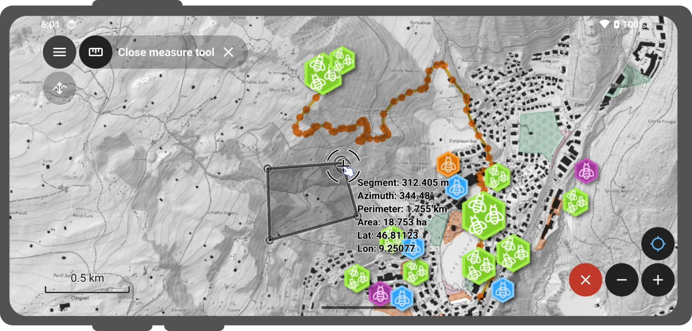
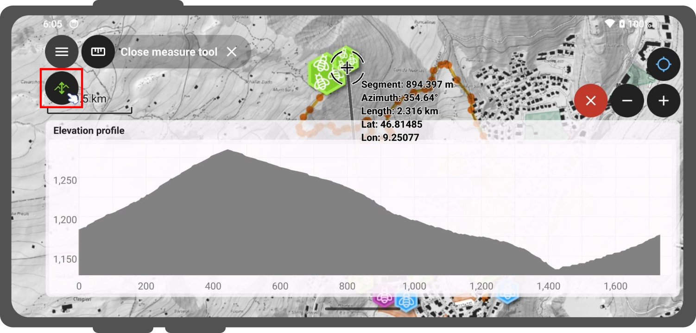

# Measuring tool

Use the **Measuring tool** in QField to measure distances, bearings, perimeters, and areas on both the 2D map canvas and the [3D map view](./3d-map-view.md).

!!! Note

    To use the Measuring tool, make sure that the crosshair is not locked to your position.

## Measuring on the 2D canvas

!!! Workflow
    1. Open the **Side Dashboard**.
    2. Tap the :material-ruler: in the top toolbar to enter measuring mode.

        !

    3. Position the crosshair over your starting point and use the :material-plus: or :material-minus: in the bottom-right corner to add or remove vertices. By default, QField measures a line geometry.
    4. (Optional) Move the crosshair back onto the first vertex to close the shape and switch the measurement to a polygon.

As you place vertices on the 2D canvas, the measurement overlay next to the crosshair displays:

- **Coordinates:** Current crosshair coordinates (`X`/`Y` or `Lon`/`Lat`).
- **Segment & Azimuth:** Planar/ellipsoidal length and bearing angle of the active segment formed by the last two vertices.
- **Length:** Total length when measuring a multi-segment line.
- **Perimeter & Area:** Total perimeter and horizontal area when measuring a closed polygon.

## Measuring in the 3D map view

You can perform terrain-aware 3D measurements directly inside the [3D map view](./3d-map-view.md).
Unlike 2D measurements, 3D measurements automatically sample the terrain elevation (`Z` value) at every added vertex to calculate true 3D slope distances and surface areas.

!!! Workflow
    1. Open the **Side Dashboard** and tap **3D** at the top to open the 3D map view
    2. Open the **Side Dashboard** again and tap the :material-ruler: (or start a measurement in 2D first and switch to **3D**).
    3. Aim the crosshair on the 3D terrain surface:
        - **Touchscreen:** Navigate the 3D view to position the center crosshair on the terrain and tap the :material-plus: or :material-minus: buttons in the bottom-right corner to add or remove vertices.
        - **Mouse, touchpad, or stylus:** Hover the cursor directly over the 3D terrain to move the crosshair, and click or tap to place vertices on the terrain surface.
    4. (Optional) Connect the crosshair back to the first vertex to close the shape into a 3D polygon draped over the terrain mesh.

    !

In the 3D map view, the measurement overlay updates its labels to indicate terrain-adjusted 3D calculations:

- **Segment (3D):** 3D slope distance between the previous vertex and the current crosshair position.
- **Azimuth:** Bearing angle of the current segment in degrees.
- **Length (3D):** Total 3D slope length along all segments of a line.
- **Perimeter (3D):** Total 3D slope perimeter of a closed polygon following terrain elevation changes.
- **Surface:** 3D inclined surface area of a closed polygon (accounting for terrain slope rather than flat horizontal area).

!!! Tip
    **Switching seamlessly between 2D and 3D measurements**

    - If you start measuring on the 2D canvas and switch to the **3D** view, QField automatically assigns terrain elevations from the 3D terrain model to your existing vertices and recalculates the 3D metrics.
    - If you close the **3D** view while measuring, your vertices remain on the 2D canvas and the readout switches back to 2D horizontal measurements (`Segment`, `Length`, `Perimeter`, and `Area`).

## Elevation profiling

To inspect elevation changes and vertical cross-sections between points on the canvas you can make use of the **Elevation Profile** tool.
This works both for 2D and 3D.

!!! Workflow

    1. Open the **Side Dashboard**.
    1. Tap on the :material-ruler: and add two or more vertices.
    2. Select the **Elevation Profile** icon in the top-left corner to open the interactive profile chart displaying terrain elevation and intersecting vector features along your measured line.

        !
