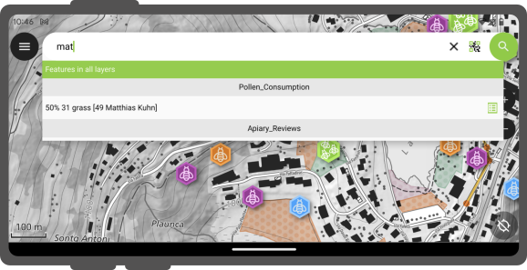

# Search Bar

The QField search bar allows you to:

- search for features within a project's vector layers
- [navigate to specified coordinates](../../fieldwork/navigation-and-positioning/navigation.md#activating-navigation)
- locate spatial bookmarks
- and calculate expressions

## Layer Search
:material-tablet: Fieldwork

Search for features across all project layers or restrict searches to the active layer.
Filter queries down to specific attribute fields.

!!! Workflow
    1. Tap the **Search** button in the top-right corner of the map canvas to expand the search bar.
    2. Enter your search query into the search bar.

### Vector Layers Search

QField uses entered text values to find features with matching attribute values.
A minimum of three characters is required to initiate a search query.

!

### Active Layer Search Feature Matching

Active layer searches focus queries exclusively on the currently active layer and its attributes.

- **Search all active layer attributes:** Type `f ` followed by your search term (such as `f oak`).
- **Target a specific attribute field:** Type `f @ATTRIBUTE_NAME search-term` (such as `f @tree_type oak`).

Matching attribute names and values are highlighted in the search results list.

Active layer searches focus queries exclusively on the currently active layer and its attributes.

- **Search all active layer attributes:** Type `f ` followed by your search term (such as `f oak`).
- **Target a specific attribute field:** Type `f @ATTRIBUTE_NAME search-term` (such as `f @tree_type oak`).

Matching attribute names and values are highlighted in the search results list.

!!! Workflow
    1. Tap **Scan code** inside the search bar to open the Code Reader interface.
    2. Scan or decode a code using one of two methods:
        - **Live Camera / NFC:** Point the camera at a physical QR code or barcode, or hold an NFC text tag near the mobile device.
            !
        - **Image File from Gallery:** Tap the **Gallery** icon on the bottom control bar and select a photo containing a QR code or barcode.
            !
    3. Tap the checkmark (**✔**) button after decoding a code to execute the search query.

## Search with Code Scanner

Use the QField Code Reader to search for features by scanning physical codes or selecting stored images.

!!! Workflow
    1. Tap **Scan code** inside the search bar to open the Code Reader interface.
    2. Scan or decode a code using one of two methods:
        - **Live Camera / NFC:** Point the camera at a physical QR code or barcode, or hold an NFC text tag near the mobile device.
            !
        - **Image File from Gallery:** Tap the **Gallery** icon on the bottom control bar and select a photo containing a QR code or barcode.
            !
    3. Tap the checkmark (**✔**) button after decoding a code to execute the search query.

Matching features display in the results list:

- Tap a feature name to pan and highlight the feature on the map canvas.
- Tap the attributes icon to open the feature attribute form directly.

!

## Search with NFC

The Code Reader automatically detects and decodes NFC text tags.

!!! Note
    The camera reader and NFC detector are active by default when opening the Code Reader.
    Toggle either sensor off inside the scanner interface to conserve battery power.

## Go to Coordinate

Navigate directly to coordinates using the search bar.

!!! Workflow
    1. Enter coordinates into the search bar in `Latitude, Longitude` format (WGS84) or coordinates matching the project CRS.
    2. Tap the coordinate result in the search list.
    QField automatically centers the map canvas on the specified location.

## Go to Spatial Bookmark

Locate and navigate to spatial bookmarks.

!!! Workflow
    1. Type `b ` into the search bar to filter for spatial bookmarks.
    2. Enter the name of your bookmark.
    3. Tap the target bookmark result.
    QField automatically pans and zooms the map canvas to the saved bookmark extent.

## Expression Calculator

The search bar functions as a QGIS expression calculator.

!!! Workflow
    1. Prefix your query with `= ` to evaluate expressions (such as `= 20 + 5` or `= $area`).
    2. Tap the calculated result in the list to copy the value to the clipboard.

Pro-tip: use the aggregate() expression function to calculate statistics against vector layers. For example, calculating the total area covered by a polygon layers
can be done by typing `*= aggregate('my_layer','sum', $area)*`.
