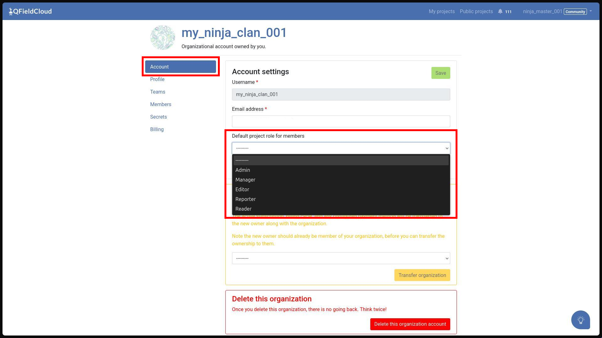
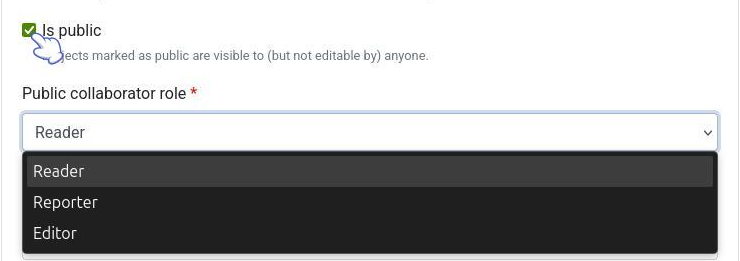
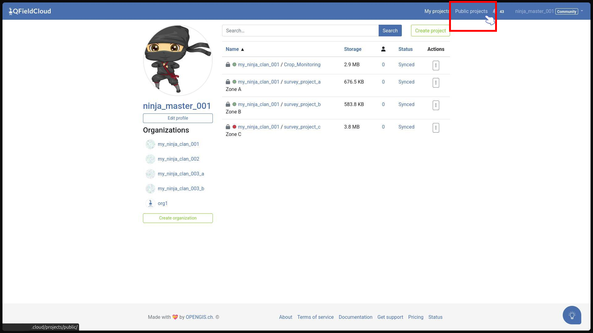

# Permissions and Roles

QFieldCloud provides fine-grained access control over projects and organizations using **Project Collaborator** roles and **Organization Member** roles.

Access permissions follow a strict hierarchy: **a higher role automatically inherits all capabilities of lower roles.**

!!! tip

    "Core Concepts Overview"

    If you are new to QFieldCloud management, ensure you are familiar with these core concepts:

    - **[Projects](../../get-started/tutorials/concepts.md#projects):** The central repositories storing QGIS project files, layer datasets, styles, and field edits.
    - **[Organizations](../../get-started/tutorials/concepts.md#organizations):** Shared accounts that own storage quotas, manage member subscriptions, and centralize project managements.
    - **[Members](../../get-started/tutorials/concepts.md#organization-members):** User accounts added to an organization with defined organization-level administrative roles.
    - **[Collaborators](../../get-started/tutorials/concepts.md#project-collaborators):** Individual user accounts granted specific access permissions to a single project.

## Project Collaborator Roles

Project roles determine what an individual user can do within a specific project.

| Role              | Summary                                                                                                                                |
|:------------------|:---------------------------------------------------------------------------------------------------------------------------------------|
| **Owner / Admin** | Full control over the project, including renaming, deleting, managing secrets, and modifying restricted project files (`.qgz`/`.qgs`). |
| **Manager**       | Can manage project collaborators and dataset files. *(Organization projects only)*                                                     |
| **Editor**        | Can create, update, and delete features and their attributes in the field. *(Organization projects only)*                              |
| **Reporter**      | Can download the project and collect **new** features in the field, but cannot edit or delete existing features.                       |
| **Reader**        | Read-only access to view and download the project. Cannot upload edits or changes.                                                     |

!!! note

    To assign more than one collaborator on private projects, the project must belong to an organization plan and collaborators must all be members of that organization.
    Alternatively, you can make a project "public" allowing all QFieldCloud users to access your project.

### Project Capabilities

The following table details what each project role can do:

| Capability \ Role                                                                                                       | Reader | Reporter | Editor | Manager | Admin / Owner |
|:------------------------------------------------------------------------------------------------------------------------|:------:|:--------:|:------:|:-------:|:-------------:|
| **View and download project files**                                                                                     |   ✅    |    ✅     |   ✅    |    ✅    |       ✅       |
| **Collect NEW features in the field**                                                                                   |   ❌    |    ✅     |   ✅    |    ✅    |       ✅       |
| **UPDATE or DELETE existing features**                                                                                  |   ❌    |    ❌     |   ✅    |    ✅    |       ✅       |
| **Upload datasets (e.g., GeoPackages)**                                                                                 |   ❌    |    ❌     |   ✅    |    ✅    |       ✅       |
| **Manage project collaborators**                                                                                        |   ❌    |    ❌     |   ❌    |    ✅    |       ✅       |
| **Manage project secrets & service credentials**                                                                        |   ❌    |    ❌     |   ❌    |    ❌    |       ✅       |
| **Upload [restricted project files](../../get-started/tutorials/tips-tricks-qfc.md#restricted-files) (`.qgz`, styles)** |   ❌    |    ❌     |   ❌    |    ❌    |       ✅       |
| **Rename or delete the project**                                                                                        |   ❌    |    ❌     |   ❌    |    ❌    |       ✅       |

## Organization Member Roles

Organizations consist of multiple members with different levels of administrative rights, ranging from basic membership to administrating the billing pages of the organization.
Below is a table that outlines the different existing organization roles.

| Role        | Summary                                                                                                                                                                                                                                                               |
|:------------|:----------------------------------------------------------------------------------------------------------------------------------------------------------------------------------------------------------------------------------------------------------------------|
| **Owner**   | Primary administrative authority. Full access over organization billing, subscription plans, ownership transfers, member management, and all organization projects.                                                                                                   |
| **Admin**   | Administrative manager. Can manage organization members, structure teams, and manage all organization projects.                                                                                                                                                       |
| **Creator** | Project creation specialist. Can create new projects under the organization and manage projects they have created, without administrative access to organization billing or member lists. They are automatically set as administrators of the newly created projects. |
| **Member**  | Standard organization user. Assigned to specific organization projects as a collaborator. Membership distinction primarily serves organizational visibility and billing seat allocations.                                                                             |

### Organization Capabilities Matrix

The following table details what each organization role can do:

| Capability \ Role                                     | Member | Creator | Admin | Owner |
|:------------------------------------------------------|:------:|:-------:|:-----:|:-----:|
| **View organization member directory & teams**        |   ✅    |    ✅    |   ✅   |   ✅   |
| **Access assigned organization projects**             |   ✅    |    ✅    |   ✅   |   ✅   |
| **Create new projects under the organization**        |   ❌    |    ✅    |   ✅   |   ✅   |
| **Add, remove, or modify organization members**       |   ❌    |    ❌    |   ✅   |   ✅   |
| **Manage organization teams & team roles**            |   ❌    |    ❌    |   ✅   |   ✅   |
| **View billing, active users, and invoices**          |   ❌    |    ❌    |   ❌   |   ✅   |
| **Modify plan subscriptions & payment details**       |   ❌    |    ❌    |   ❌   |   ✅   |
| **Delete organization or transfer primary ownership** |   ❌    |    ❌    |   ❌   |   ✅   |

### Default Project Role for Organization Members

As an organization, you have the option to configure a **Default Project Role for Members** in the **Organization settings**.

When you add organization members to an organization project, QFieldCloud automatically assigns this default role without requiring manual changes to the collaborator role for each newly added collaborator.

!

## Key Security Features

### Restricted Project Files

When the **Restrict project files** setting is enabled on a project, standard **Editors** and **Managers** can continue updating datasets (such as GeoPackages), but they are blocked from modifying or replacing core project files (such as `.qgz` or `.qgs` project files and style templates).

Only **Admins** and **Owners** can modify restricted files.

### Private vs. Public Projects

Each project can be configured as **Private** or **Public** when creating a project or inside the project settings:

!!! Workflow

    :material-monitor: Project Manager

    1. Log into QFieldCloud and select your project.
    2. Navigate to **Settings** in the project menu.
    3. Check or uncheck **Is public**.

    !

In QFieldCloud, the status icon next to the project name indicates project visibility: a lock icon (🔒) represents a Private project, while an unadorned project title represents a Public project.

- **Private Projects:** The project owner, organization owner, and organization admins are automatically assigned the **Admin** project role. Anyone else trying to access the project will be denied unless they are explicitly added as project collaborators.

!!! Note
    To assign collaborators on a **Private** project owned by an organization, all candidate collaborators must be members of that organization. In addition, the total number of collaborators cannot exceed the owner's subscription plan limits.

- **Public Projects:** The project owner, organization owner,
    and organization admins automatically receive the **Admin** project role.
    All other authenticated QFieldCloud users receive a default base permission defined by the [**Public Collaborator Role**](#public-collaborator-role).

!

### Public Collaborator Role

When enabling **Public project** during project creation or in the project settings, a **Public collaborator role** field will automatically appear below the checkbox.

This setting defines the default role granted to any QFieldCloud user accessing who wishes to download that public project:

- **Public Collaborator Role:** You can choose between the roles **Reader** (read-only access), **Reporter**  or **Editor**.
Read [here](#project-capabilities) about which role is appropriate for your needs.
- **Default Role:** If you mark a personally owned project as **public** and do not define the **Public Collaborator role**, it will default to the  **Reader** role.
For organization-owned projects, if you do not define the **Public Collaborator role**, QFieldCloud will use the organization's **Project Role for Members** setting.
If no **Project Role for Members** is defined, it will default to the  **Reader** role.
- **External Non-Member Collaborators:** On public organization projects, users who are **not members** of the organization can be explicitly added as collaborators with custom roles without being counted to the number of actual members .

### Converting Public Projects to Private

When converting a **Public** project to **Private**, QFieldCloud enforces validation checks before saving the setting change:

1. **Non-Organization Collaborators Check:** If an organization-owned project has collaborators who are not members of the organization, you must either remove them or add them as organization members before setting the project to private.
2. **Subscription Plan Limits Check:** The total number of collaborators cannot exceed what the owner's subscription plan allows for private projects. Remove excess collaborators before changing visibility to private.

!!! Note
    If a subscription downgrade occurs on an existing private project that exceeds the plan limit, the project remains private but shifts to a locked status until collaborator counts are brought within plan limits or the plan is upgraded.
