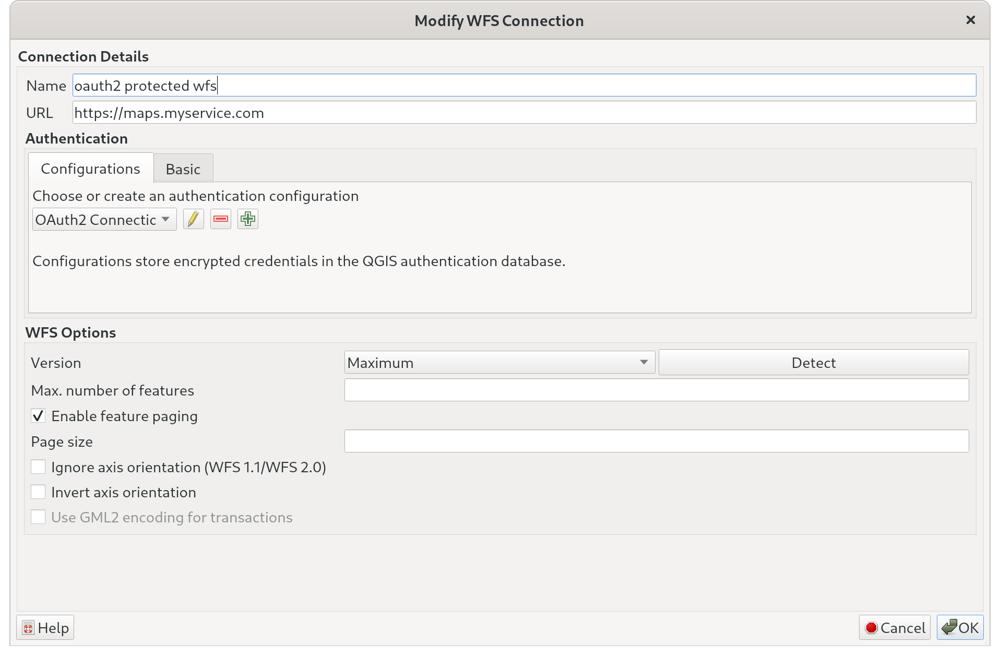
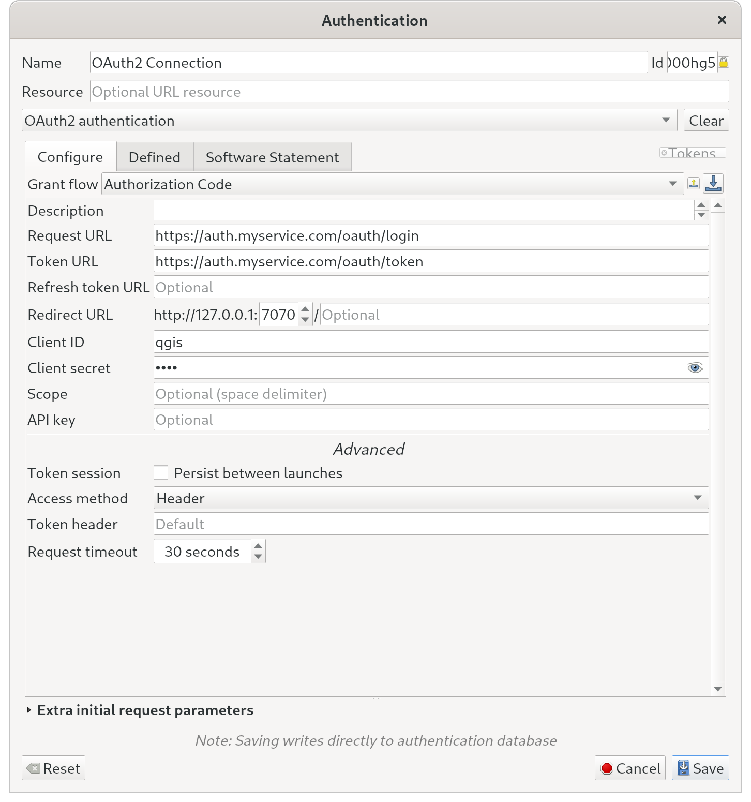
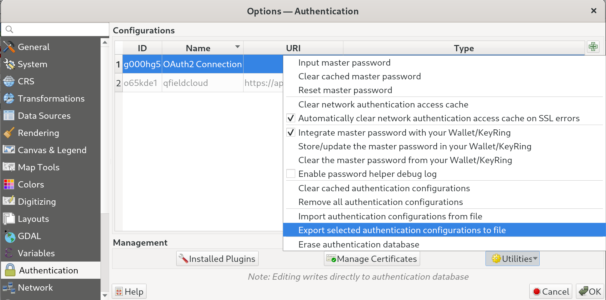

# Authentication

QField supports connecting to web services requiring user or token authentication.
This page details configuring OAuth2 services in QGIS and exporting authentication configurations to QField mobile devices.

## OAuth2-protected web services in QGIS
:material-monitor: Desktop preparation

Before loading the OAuth2-protected web layers (such as WFS or WMS) into QField you need to configure  them accordingly in in QGIS.

!!! Workflow
    1. In QGIS, navigate to _Layer > Add Layer > Add WFS / OGC API Feature Layer..._.
    2. Click **New** or select an existing service connection and click **Edit**.
    3. Under the **Authentication** section, click the green plus (**+**) button to add a new authentication configuration.
    4. Set **Type** to **OAuth2** and adjust parameters to match your OAuth2 provider server setup.
    5. Save the configuration and verify that layers load correctly on the QGIS canvas.

!

!

## Export authentication configurations from QGIS
:material-monitor: Desktop preparation

Prior to exporting authentication configurations, it is always good to verify that you are able to properly connect to relevant services using QGIS.

!!! Workflow
    1. In QGIS, navigate to _Settings > Options... > Authentication_.
    2. Select target configuration entries in the configurations table.
    3. Click **Utilities** and select **Export selected authentication configurations to file...**.
    4. When prompted for an encryption password, leave the password field **blank**.

!

    !!! Warning

        You will be warned that you might be leaking sensitive information, which is a good reminder to treat the resulting XML with caution.

## Import authentication configurations into QField
:material-monitor: Desktop preparation

In order for a service that requires authentication to run in QField, after configuring the required credentials in QGIS, the information needs to be added into QField as well.

!!! Workflow

    1. Export the authentication configuration file from QGIS (see above)
    2. On your device direct to the QField *[App Directory](../../how-to/project-setup/storage.en.md#5-qfield-app-directory)* > *Auth*
    3. Once copied, the service should be rendered correctly and provide access.

!!! Tip
    For interactive authentication methods (such as OAuth2), QField opens an in-app browser dialog prompting for user credentials, passwords, or two-factor authentication (2FA) verification codes when connecting to services.
