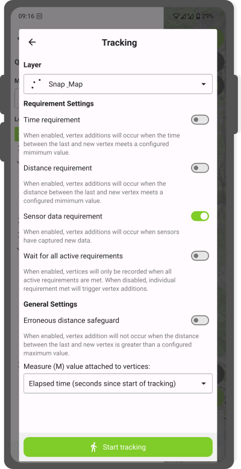

# Sensors

QField supports background sensor logging, allowing you to passively collect sensor data, display live measurements on the map canvas, and store readings inside feature attribute fields.

See [Here](../../fieldwork/data-collection/sensors.md) how this looks in QField.

## Configuration of Sensors

Follow the official [QGIS documentation](https://docs.qgis.org/latest/en/docs/user_manual/introduction/qgis_configuration.html#sensors-properties) to configure your project.

## Sensor-Driven Tracking

You can configure the QGIS project in such a way that QField will automatically track the values from the sensor in a point layer, saving collected sensor data linked to the current position.

!!! Workflow

    1. Open the **layer properties** of the point layer, where the sensor data will be stored.
    2. Switch to the **Attribute Layout** Tab.
    3. Set the **default value** to `*"sensor_data('abc')` where 'abc' corresponds to the name of the sensor.
    4. Click **Apply** and synchronize or copy your modified project to the mobile device.

    !

    !
