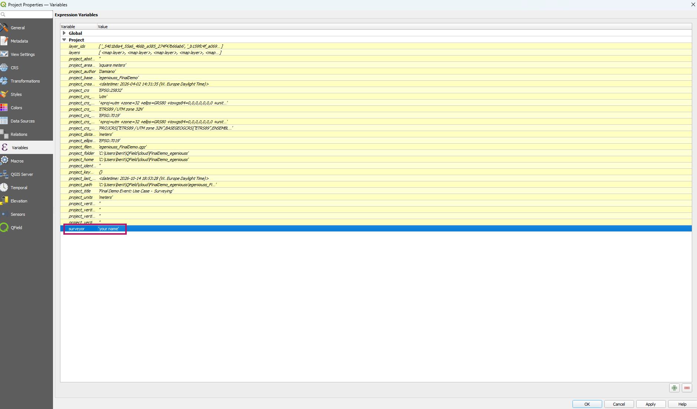

# Variables

QField allows users to add and edit expression variables.
These can be used for a wide range of applications, including data-defined symbology, setting default field values, controlling print layout and application behavior, and much more.
See [the relevant QGIS documentation](https://docs.qgis.org/latest/en/docs/user_manual/introduction/general_tools.html#storing-values-in-variables) for more information. <!-- markdown-link-check-disable-line -->

QField supports two main types of custom variables:

- **Project Variables:** Project-bound variables defined within the project file.
- **Global Variables:** Application-wide global variables with a set of read-only variables.

## Project Variables

Project variables are defined and managed directly within the QGIS project on your desktop.
They allow you to add custom variables that are only relevant in the context of a specific project.
QField users can edit those variables, with modified values remembered across sessions.

!!! Workflow

    **Adding a Project Variable**

    1. In QGIS direct to _project > properties_.
    2. Change to the **Variables** section.
    3. Add your project variable (eg. surveyor)
    !

## Global Variables

QField comes pre-configured with some read-only global variables which are visible in under side *Dashboard* > *Settings* > *Variables*.
New variables can be added or modified and will be available in QField across sessions.

!!! Information
    The read-only variables differ from device to device.
    These reflect the global variables from the specific QGIS version that was being used to develop the installed version of QField.

## Useful Examples

Common variables to use are:

- **@cloud_username** to incorporate the details of the individual users in a project.

!!! note
    If you are not using QFieldCloud you can add a unique identifier instead.

- **@qgis_locale** to use the currently set language of QGIS/QField.

Since the application-wide variables are not bound to specific projects and are defined locally, they are a great way to optimize the fieldwork experience for multiple users sharing the same projects.

!

See [here](../../fieldwork/data-collection/variables.md) how to work with variables in QField directly
