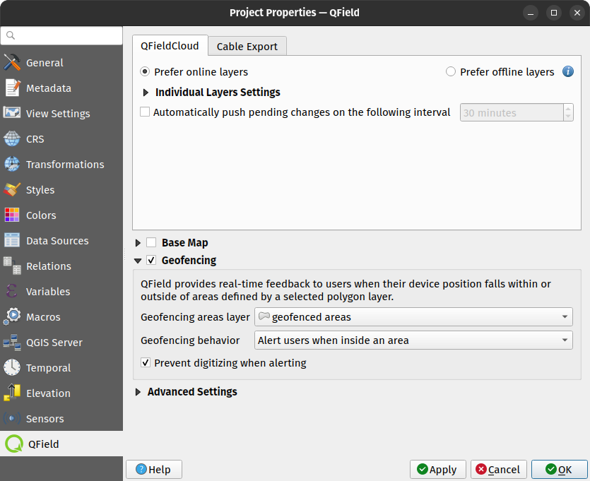

# Geofencing

QField includes built-in geofencing functionality to alert or inform users when their GNSS location enters or exits predefined polygon boundary areas.
You can also prohibit feature digitizing when a geofencing alert is active.
Configure geofenced boundaries in QGIS using QFieldSync.

## Defining Geofenced Areas
:material-monitor: Project Manager

!!! Workflow

     :material-monitor: Desktop preparation

     1. *Project* > *Project Properties* > *QField*
     2. Check the checkbox where it says **Geofencing**
     3. Select the polygon layer that you wish to use as a **Fence**
     4. Select further the geofencing behaviour.
     There exist to options by default:
         - **Alert users when inside an area**: Whenever a user is entering one of the areas that define the geofenced area, the user will get a notification at the bottom of the screen.
         - **Alert users when outside all areas**: Whenever a user is stepping outside the area that define the geofenced area, the user will get a notification at the bottom
         - **Inform users when entering and leaving areas**: A combination of the two other options.
    !

     5. Check the checkbox if you do not want the users to add new features within (1st option) or outside (2nd option) of the selected area.
