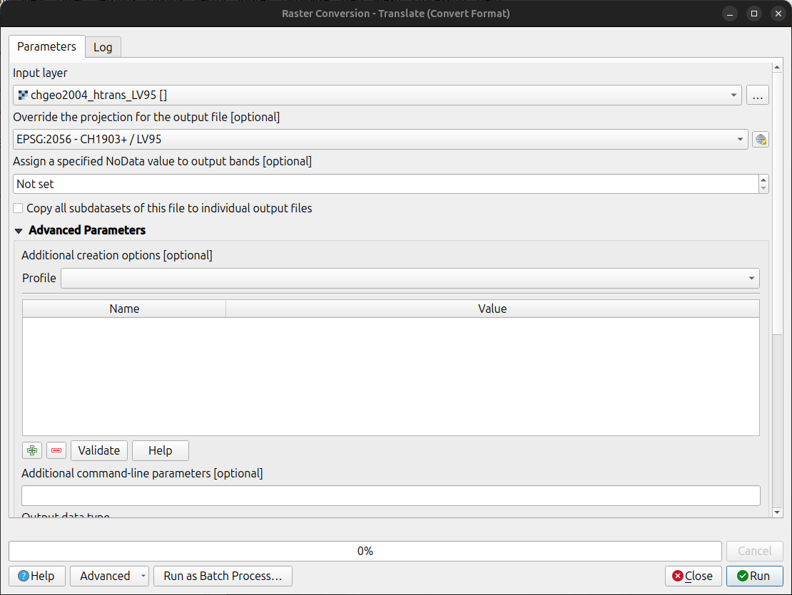
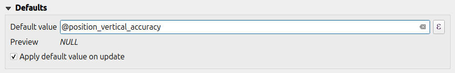
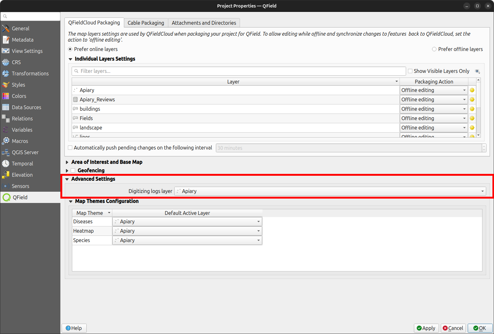

# Positioning (GNSS)
:material-tablet: Fieldwork

QField is capable to show the live position using several sources:

- Either by using the internal GNSS (Global Navigation Satellite System, like GPS, GLONASS, Galileo or Beidou) of the mobile device (typically 5 m accuracy) or
- Through an external antenna through NMEA streams over Bluetooth, TCP, or UDP connection. (typically 1.5 m accuracy) or
- Through an external antenna connected to an additional NTRIP service (down to cm accuracy)

!!! Tip
    Use an external GNSS antenna for high-accuracy surveying, as internal mobile GNSS hardware is limited to roughly 5 meters of accuracy.
    External receivers also provide accurate elevation measurements alongside 2D coordinates.

!!! Note
    QField requires external GNSS devices to output positioning data in the `EPSG:4326` (WGS 84) coordinate reference system.
    Customized device output CRSes are not supported and will cause coordinate shifts.

## Using an external GNSS Receiver

QField supports connecting to external GNSS positioning devices via NMEA streams through Bluetooth, TCP,
or UDP connections.

The breakdown of connections support by platform is as follow:

|             | :material-android: Android | :material-apple: iOS | :material-microsoft-windows: Windows | :material-linux: Linux | :material-apple: MacOS |
|-------------|----------------------------|----------------------|--------------------------------------|------------------------|------------------------|
| Bluetooth   | :material-check:           | :material-check:     |                                      | :material-check:       | :material-check:       |
| TCP         | :material-check:           | :material-check:     | :material-check:                     | :material-check:       | :material-check:       |
| UDP         | :material-check:           | :material-check:     | :material-check:                     | :material-check:       | :material-check:       |
| Serial port | :material-check:           |                      | :material-check:                     | :material-check:       | :material-check:       |

*(\*) Bluetooth support on Windows occurs through the virtual serial port automatically
created by the operating system when it connects to the GNSS device.*

The NMEA sentences currently supported are GGA, RMC, GSA, GSV, GST, VTG, HDG and HDT.

## Antenna height compensation

The height of the antenna pole in use can be defined in the settings.
Any measured altitude will be corrected by this value.

## Altitude correction (vertical grid shift)

Altitude values can be corrected with vertical grid shift files to calculate orthometric height.

Vertical grid shift files have to be made available to QField by putting them into the QField app folder **[[App Directory]](../../fieldwork/general/storage.md#5-qfield-app-directory)/QField/proj**.
Once the grid shift file is placed there, it is available in QField in the *Positioning settings* under *Vertical grid shift in use*.


!!! Note

    This is independent of whether QFieldCloud is used or not.

Supported grid shift file formats include:

- GeoTIFF (`.tif`, `.tiff`)
- NOAA Vertical Datum (`.gtx`)
- NTv2 Datum Grid Shift (`.gsb`)
- Natural Resources Canada Geoid (`.byn`)

#### Example: Netherlands (ETRS89 to NAP)

!!! Workflow

    **Example:  Netherlands - ETRS89 to NAP**

    For transformations involving the Dutch **NAP (Normaal Amsterdams Peil)** vertical datum, you'll need the official grid file from NSGI.

    1. **Download the file**: Get `nlgeo2018.gtx` directly from the [NSGI website](https://www.nsgi.nl/rdnaptrans).<!-- markdown-link-check-disable-line -->
    2. Place the downloaded `.gtx` file into the directory **[[App Directory]](../../fieldwork/general/storage.md#5-qfield-app-directory)/QField/proj**.

    **Example: Switzerland - CH1903+/LV95**

    To get precise altitude data for **Cadastral Surveying in Switzerland (LV95)**, you must use the geoid correction grid from Swisstopo.
    The official file comes in an `.agr` format and must be converted to `.gtx` (NTv2 Grid Shift File) before it can be used.
    Other raster formats like (.tiff) can also be used.

    1. Download the "Geoid OGD" dataset from Swisstopo under the following link **Download Link**: [Geoid OGD from Swisstopo](https://cms.geo.admin.ch/ogd/geodesy/Geoid_OGD.zip)<!-- markdown-link-check-disable-line -->.
    2. Unzip the archive to retrieve the file: `chgeo2004_htrans_LV95.agr`.
    3. Convert the file using the using the [gdal_translate](https://gdal.org/en/stable/programs/gdal_translate.html) algorithm with one of the following options:

        ***Method 1: QGIS Graphical User Interface (GUI)***

        1. In QGIS, open the Processing Toolbox panel.
        2. Navigate to *GDAL* > *Raster conversion* > *Translate (Convert format)* tool.
        3. Configure it with your needed requirements:
            - **Input layer**: Select your `chgeo2004_htrans_LV95.agr` file.
            - **Output file**: Click "Save to File..." and name your output file with a `.gtx` extension (or other format needed), for example, `chgeo2004_htrans_LV95.gtx`.
        4. Click **Run**. The other default settings are typically sufficient for this conversion.

        !

        **Method 2: Command Line (`qgis_process`)**

        For automation or users who prefer the command line, `qgis_process` is a great option.

        1. Open your terminal and run the following command, adjusting the paths to your files.
        ```bash
        qgis_process run gdal:translate --INPUT="/path/to/your/chgeo2004_htrans_LV95.agr"
            --OUTPUT="/path/to/your/chgeo2004_htrans_LV95.gtx"
        ```

        ***Method 3: PyQGIS Script***

        You can also perform the conversion programmatically within the QGIS Python Console or a standalone script.

        ```python
        import processing

        input_grid = '/path/to/your/chgeo2004_htrans_LV95.agr'
        output_grid = '/path/to/your/chgeo2004_htrans_LV95.gtx'

        processing.run("gdal:translate", {
            'INPUT': input_grid,
            'OUTPUT': output_grid
        })

        print(f"Successfully converted grid to: {output_grid}")
        ```

    See [here](../../fieldwork/navigation-and-positioning/gnss.md#positioning-variables) how it should be added to QField.

## Positioning variables

You can write the positioning information both of your internal and external device by specifically configuring your attribute form accordinglz.

These variables are commonly used as part of [default values expressions](https://docs.qgis.org/latest/en/docs/user_manual/working_with_vector/vector_properties.html#default-values)<!-- markdown-link-check-disable-line -->
for fields to keep track of the quality of individual measured points.

For example, record horizontal accuracy using `@position_horizontal_accuracy`.
Refer to the [Expression Variables Reference](../../reference/expression_variables.md) for a complete list.

Elevation handling based on vertical grid shift settings (with antenna compensation disabled):

| Vertical Grid Shift in use | point Z Value z(geometry) | GNSS Device z(@position_coordinate) | QField Display | QField Label                |
|----------------------------|---------------------------|--------------------------------------|----------------|-----------------------------|
| None                       | Z ellipsoidal device value| Z ellipsoidal device value           | Z ellipsoidal device value | Altitude: xxx.xxxx m       |
| Orthometric from device    | Z orthometric device value| Z orthometric device value           | Z orthometric device value | Altitude: xxx.xxxx m (ortho.) |
| USER_Shift_Grid.GTX <br> [vertical grid shift](#altitude-correction-and-vertical-grid-shift)        | Z shiftgrid value         | Z ellipsoidal device value           | Z shiftgrid value          | Altitude: xxx.xxxx m (grid) |

### Capturing Coordinates in Attribute Forms
:material-monitor: Project Manager

Store longitude, latitude, and altitude automatically in feature forms using default expressions:

!!! Workflow
    1. In QGIS, navigate to _Vector Layer Properties... > Attribute Form_.
    2. Add decimal fields for coordinate storage (such as `longitude`, `latitude`, `altitude`).
    3. Assign default value expressions:
        - **Longitude:** `x(@position_coordinate)`
        - **Latitude:** `y(@position_coordinate)`
        - **Altitude:** `z(@position_coordinate)`

Coordinates populate automatically when digitizing new features while locked to GNSS positioning.

### Vertex Log Layer
:material-monitor: Project Manager

Create a dedicated vertex log layer to record metadata for every digitized point:

!!! Workflow
    1. Add a point vector layer to your QGIS project with attribute fields configured for positioning variables.
        !
    2. Assign the **digitizing logger** role to the layer under _Project > Properties... > QField_.
        !
    4. Set default values to the attributes using the positioning variables mentioned above.
