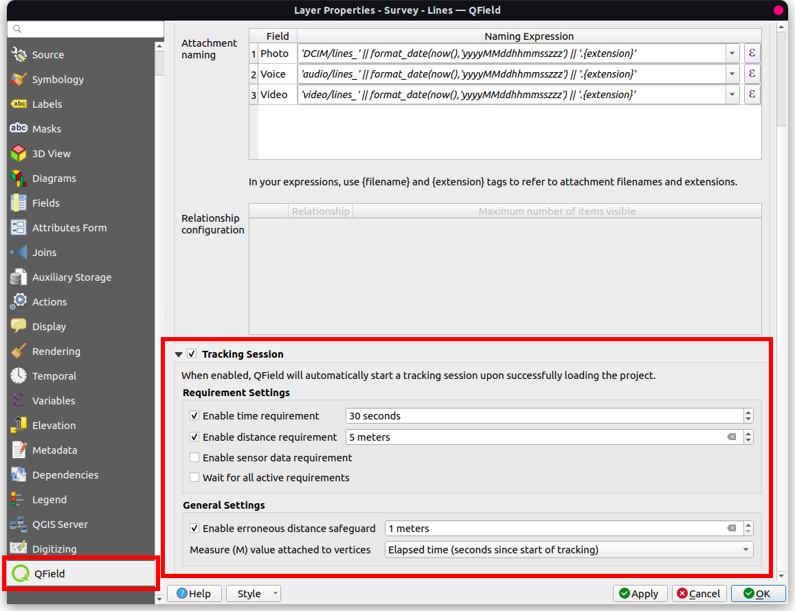
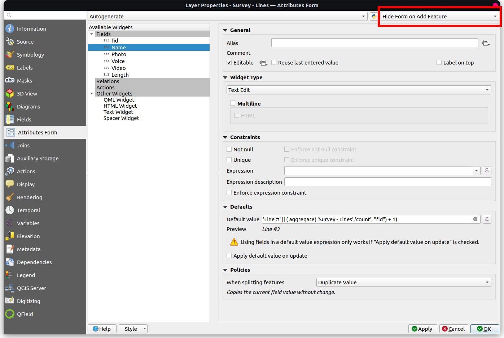

# Tracking

## General Settings
:material-tablet: Fieldwork

QField allows you to track your position through the creation of points, lines or polygons while browsing the map, working on other features and layers, or in the background while having the device in your pocket.

See [Here](../../fieldwork/navigation-and-positioning/tracking.md) how it looks in QField.

## Automatic Tracking Session

You can configure the QGIS project in such a way that one or more position tracking sessions automatically start when opening a project in QField.
The feature form of the layer will immediately open asking for the attributes.
You can also hide the attribute form so that the tracking session automatically starts.

!!! Workflow

    1. In QGIS, navigate to _Vector Layer Properties... > QField_.
    2. Enable **Tracking Session** and define time or distance requirements.
        !
        !
    3. (Optional) To bypass feature form prompts when auto-tracking begins, navigate to _Vector Layer Properties... > Attribute Form_ and select **Suppress attribute form**.
        !

- **Efficiency**: Automation saves time and effort in the field.
- **Flexibility**: Users can customize sessions and start sessions without entering any attribute information by customising the feature with default values.
