# Attribute Form

Configure feature attribute forms in your QGIS project before performing fieldwork.
Form configuration in QGIS for QField operates similarly to standard QGIS projects, with specific mobile optimizations.

## Attribute Form Configuration

To configure an attribute form, open vector layer properties by navigating to _Vector Layer Properties... > Attribute Form_ in QGIS.

Select appropriate widget types based on the expected behavior of each attribute.
The table below summarizes attribute widget types supported in QField.

Below is an overview what  **widget types** are available and supported in QField.

| Widget type        | Support          | Notes                                                                                                                                                                                                  |
|--------------------|------------------|--------------------------------------------------------------------------------------------------------------------------|
| Attachment         | :material-check: | This field is combined with camera integration, to know more jump to [Attachment (photo settings)](#attachment-widget)   |
| Color              | :material-check: |                                                                                                                          |
| Date / Time        | :material-check: |                                                                                                                          |
| Checkbox           | :material-check: |                                                                                                                          |
| Hidden             | :material-check: |                                                                                                                          |
| Range              | :material-check: | Editable spinbox and slider                                                                                              |
| Relation Editor    | :material-check: |                                                                                                                          |
| Relation Reference | :material-check: |                                                                                                                          |
| Text Edit          | :material-check: |                                                                                                                          |
| Value Map          | :material-check: | Combobox or radio button (the latter unique to QField)                                                                   |
| Value Relation     | :material-check: | Combobox or radio button (the latter unique to QField)                                                                   |
| UUID Generator     | :material-check: |                                                                                                                          |

QField also supports container widgets:

| Widget type        | Support          | Notes                                                                                                                                                                                                  |
|--------------------|------------------|--------------------------------------------------------------------------------------------------------------------------|
| QML widget         | :material-check: |                                                                                                                          |
| HTML widget        | :material-check: |                                                                                                                          |
| Text widget        | :material-check: |                                                                                                                          |
| Spacer widget      | :material-check: |                                                                                                                          |

For other attribute widget types not yet supported, consider [sponsoring an implementation](../../get-started/contribute.md#feature-sponsoring).

## General Attribute Settings
:material-monitor: Project Manager

To configure your attribute form there are some other general useful settings, which you can find in
_Vector Layer > Properties > Attribute form_ (see image below).

!

- **Drag and drop designer":** Organize form layouts using containers such as tabs and groups.
    Incorporate conditional visibility rules and default values to enhance form interactivity.
    Read more in the [QGIS Drag and Drop Designer Documentation](https://docs.qgis.org/latest/en/docs/user_manual/working_with_vector/vector_properties.html#vector-attributes-menu). <!-- markdown-link-check-disable-line -->

- **Hide attribute form upon**: You can hide the attribute form by changing from the "Show form on Add Feature" to the setting "Suppress attribute form".
    When adding a new feature in QField, no attribute form needs to be populated.
    **Note**: In such a case, you have to configure the attribute form in such a way that all constraints/rules are met even if you do not add any attributes.

- **Editable**: You can decide whether a field is editable or not by activating it in the widget display of the corresponding field.

- **Remember last values**: If you don't want to add the same value again and again you can enable this option under the widget display in QGIS.
    QField, however, offers a more fine-grained control over the last used values.
    If you enable this option in QGIS, the rule will always apply.
    With QField you can change and disable this option at any point during data collection.

- **Default values":** Pre-fills attribute fields using QGIS expressions.
    QField supports positioning variables (such as [GNSS variables](../../reference/expression_variables.md#positioning-and-gnss-variables))
    and [QFieldCloud variables](../../reference/expression_variables.md#qfieldcloud-variables).


---

## Feature Form Wizard Mode

QField supports **Wizard Mode** for feature forms containing multiple root tabs.
When enabled, forms transform into a step-by-step, linear sequence.

Wizard Mode provides a guided workflow for field workers filling out complex forms, enforcing data constraints sequentially across form pages.

!!! Note
    Wizard Mode requires organizing form fields into multiple tabs.


To use Wizard Mode, your feature form must first be set up into tabs.

!!! Workflow

    1. Direct to _Vector Layer Properties > Attribute form_
    2. Use the **"Drag and drop designer"** and rearrange your fields with multiple tabs.
    !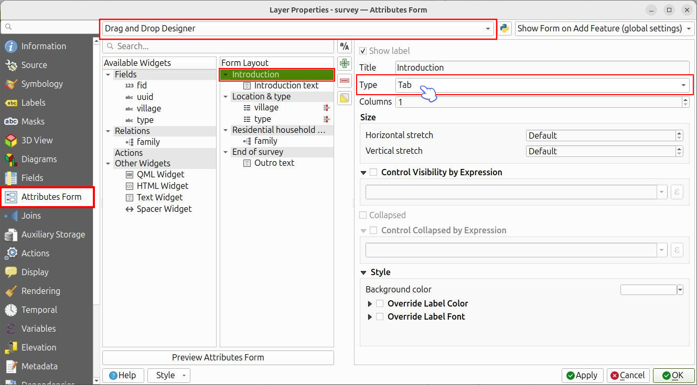
    3. Open your project in QGIS.
    4. Direct to *Project* > *Project Properties...* > *QField*.
    Alternatively you can click on the settings icon from the QFieldSync plugin panel.
    5. Check  **"Enable QField feature forms' wizard mode"**.
    6. Save your project and synchronize it to QFieldCloud.
    !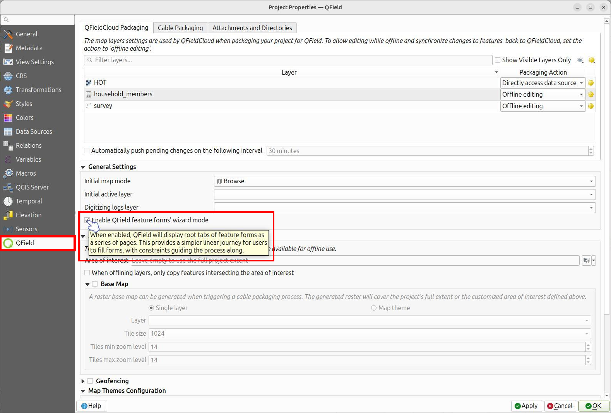
    This is how it will look in QField:
    

## Working with Relations

:material-monitor: Project Manager

For detailed information on setting up layer relations in QGIS, refer to the [QGIS Relations Documentation](https://docs.qgis.org/latest/en/docs/user_manual/working_with_vector/joins_relations.html#setting-relations-between-multiple-layers). <!-- markdown-link-check-disable-line -->

## Value Map Widget Configuration

When using value maps as a widget type you can decide whether you want the value options as a list or buttons.
You select the maximum number of values with which the threshold between list and buttons will be set.

!

!!! Workflow

    1. Direct _Vector Layer Properties > QField_

    2. Under the **Feature Form Settings** enable and define the maximum **quantity of items** above which the when the selection option changes from buttons to the list format
    !.

## Attachment Widget

The **Attachment** widget stores file paths for feature media and documents.

Use the Attachment widget to:

- Capture photos or select pictures from the gallery.
- Record audio clips.
- Record video files.
- Link external documents (such as PDF files).
- Draw sketches directly in QField.

!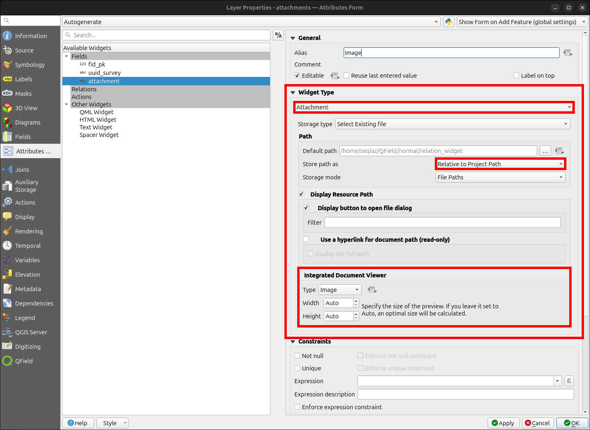

!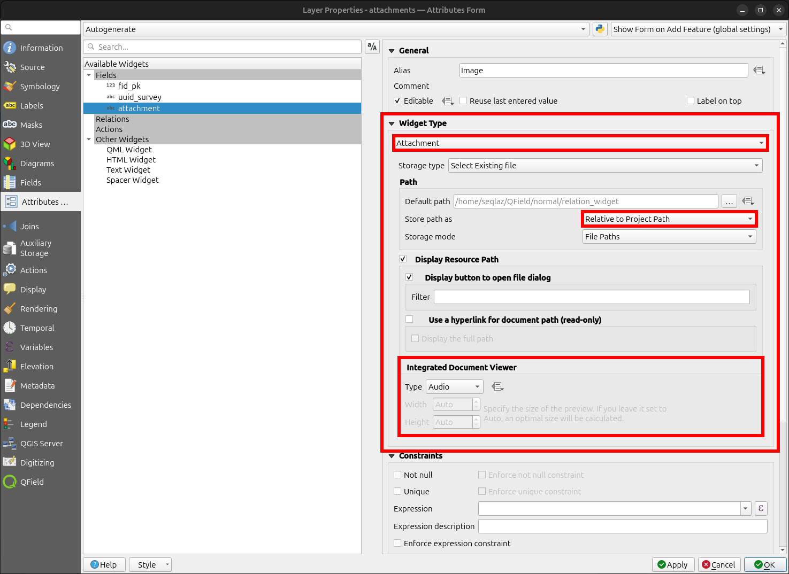

!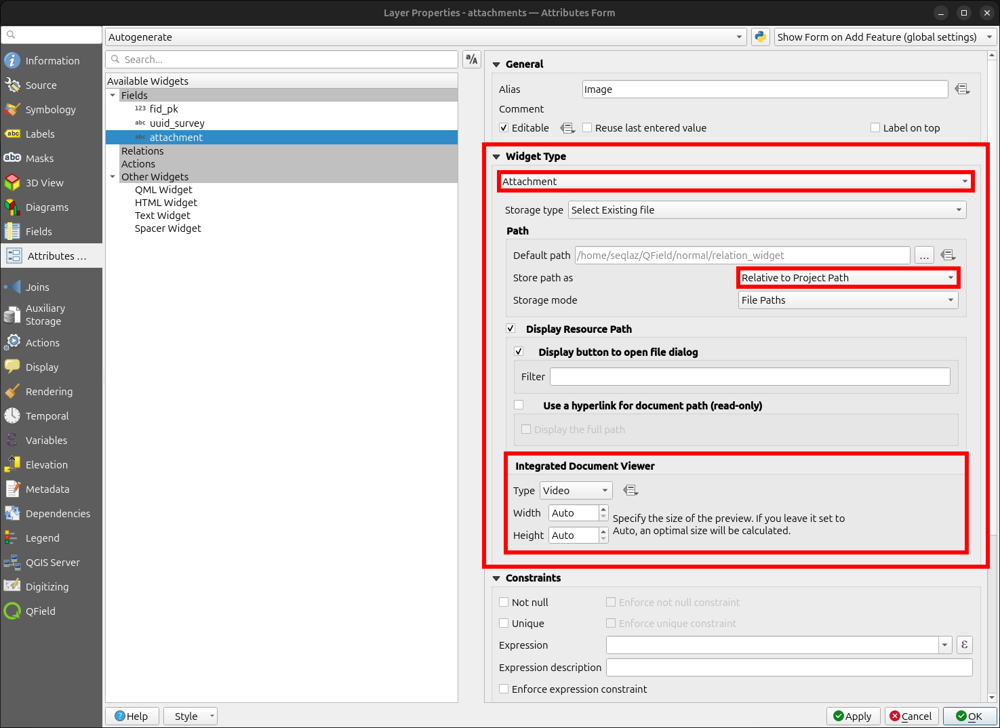

!!! Note
    Set attachment file paths to relative.
    QField stores media files in project subdirectories referenced by text attribute fields.

Checkout the page for the [attachment widget](../../how-to/project-setup/pictures.md) to get specific guidance for this widget.

## Value Relation Widget

The **Value Relation** widget displays values from a related layer in a combobox or toggle button layout.

The Value Relation widget supports toggle button interfaces similar to Value Map widgets.

Configure the following parameters:

- **Layer:** Select the layer containing lookup values.
- **Key column:** Select the attribute column containing saved key values.
- **Value column:** Select the attribute column displaying readable labels during data collection.
- **Order by Value:** Sort displayed values by key, value, or a specified column.
- **Group column:** Group lookup values using another attribute column (such as grouping tree species by genus).
When grouped, QField displays the widget as a list regardless of toggle button settings.
- **Allow NULL value:** Allows leaving the field blank.
- **Use Completer:** Enables auto-complete searching across available lookup values.
- **Allow multiple selections:** Allows selecting multiple lookup values for a single feature.


### Group Value Configuration

!!! Workflow

    1. Choose the column that will be used to organize the items.
    The values from this column will act as group title.

    2. (Optional) Enable **Display group name** if you want to add the title of your group as a distinct header.
    This creates a clear separation between the different groups, making the list easier to navigate.

!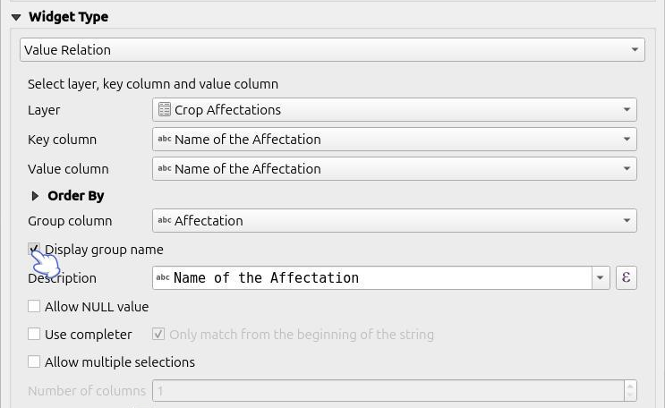

!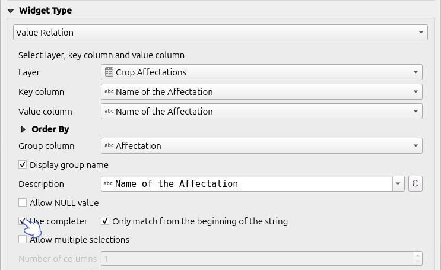

!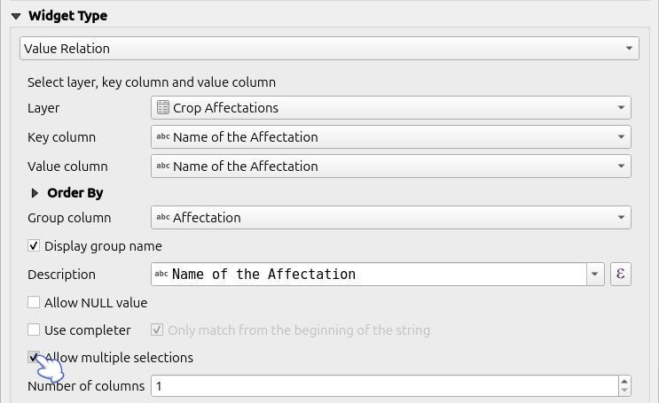

!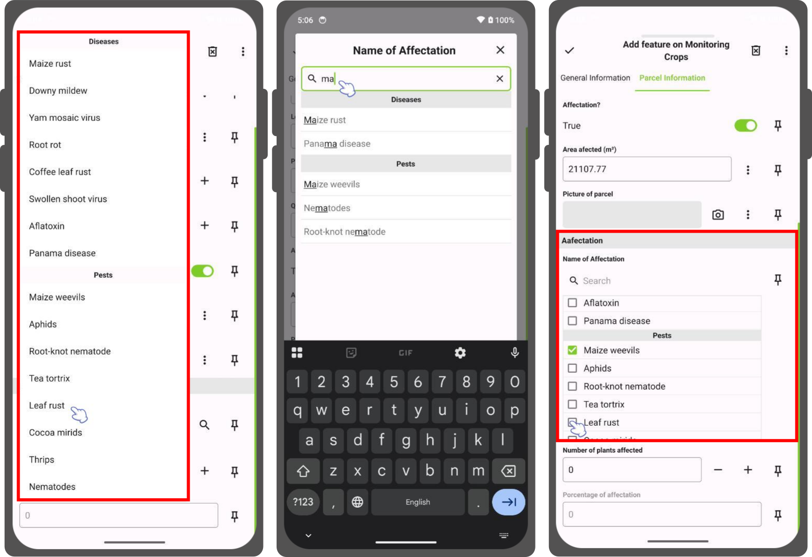

### Configuration of Autocomplete

!!! Workflow

    1. Direct to _Vector Layer Properties. > Attributes Form_.

    2. Your widget type needs to be **Value Relation**.

    3. Enable the **Use completer** option.

    !

:material-tablet: Fieldwork

!

## Conditional Visibility

You can hide whole groups based on expressions.
This is useful when certain attributes are only required under certain conditions.
!!! Workflow

    **Example: Accessing the status of tree species**

    *Some of them might have a disease and you have a list of possible diseases.*

    1. Create a group.

    2. Define a visibility expression for the group.
    *Eg. Only if the tree is marked as "sick", the field "disease" will appear.*

    3. Add the field that is to be shown only after the expression criteria is set into the group.
    *Eg. We will add our "type of disease" field into the group.*

!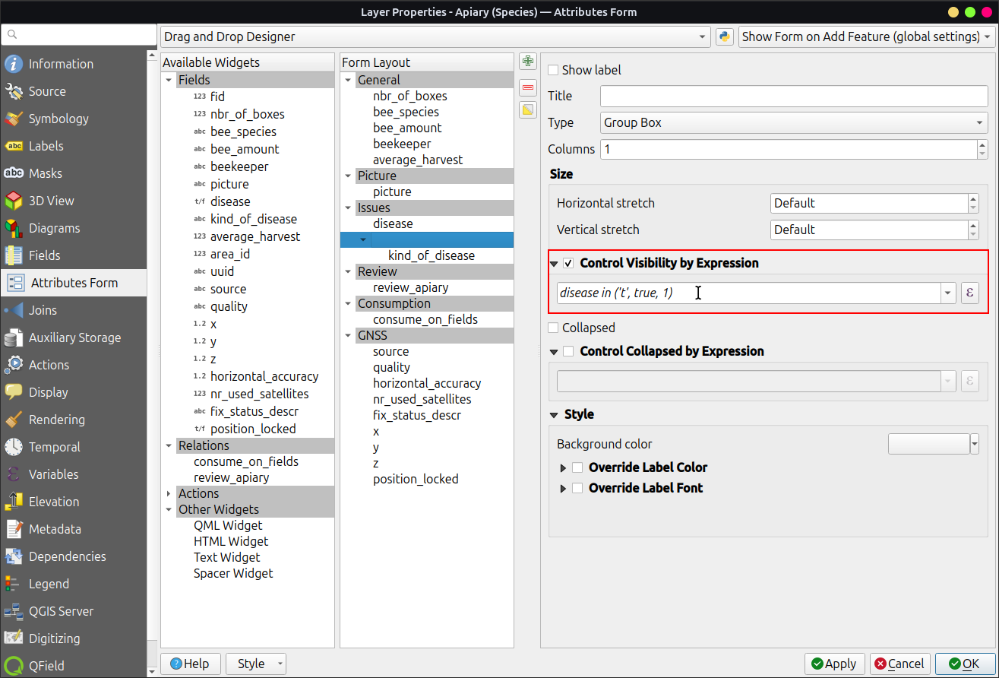

:material-tablet: Fieldwork


## Conditional Row Styling

QField supports QGIS's conditional row styling, providing immediate visual feedback when browsing features via list views (such as identify results or relation lists).
You can use expressions to dynamically change the background color, text color, and font properties (italic, underline, strikeout) of individual items in the feature list based on their data.

!!! Note
    QField supports full row styling in feature lists.

!!! Workflow
    1. Open your project in QGIS.
    2. Right-click your vector layer in the Layers panel, select **Open Attribute Table**, and click **Conditional Formatting**.
    3. Switch to the **Full row** tab at the top of the Conditional Formatting panel.
    4. Click **New Rule**.
    5. Enter an evaluation expression (such as `"status" IS 'Good'`).
    6. Configure visual formatting options:
        - **Background color**
        - **Text color**
        - **Font styles** (Italic, Underline, Strikeout)
    7. Click **Done** to save the rule.
    8. Save your QGIS project and synchronize it to QField.

!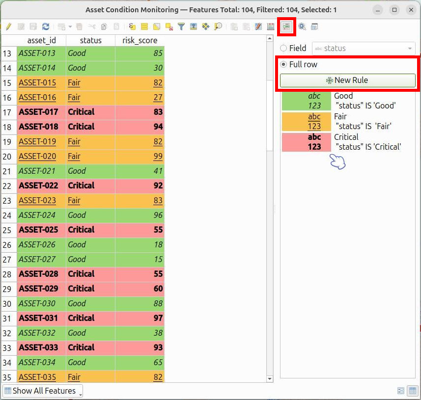

## Define Constraints

Attribute fields can have constraints attached.
Constraints are rules in the form of expressions.
Before a feature can be saved all constraints need to be met.
A description can be added that is shown if a constraint is not satisfied.

!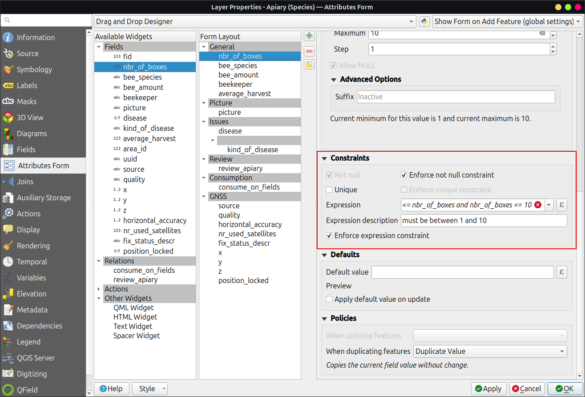

Examples of constraint expressions:

- Restrict elevation values:
    ```sql
    "elevation" < 5000
    ```
- Require non-null identifiers:
    ```sql
    "identifier" IS NOT NULL
    ```

## Define Default Values

Configure default values to pre-fill attribute forms when digitizing new features.
Default values remain editable in the form unless fields are locked.

!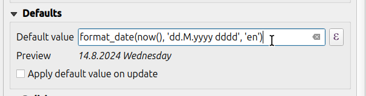

!!! Attention
    Avoid enabling **Apply default value on update** for primary key fields.

## Working with Expressions

Use Layer Names rather than Layer IDs when building expressions for QField.
QFieldSync conversion jobs may assign new internal Layer IDs, causing expressions referencing static Layer IDs to fail.
Referencing Layer Names ensures consistent expression evaluation across project exports.

!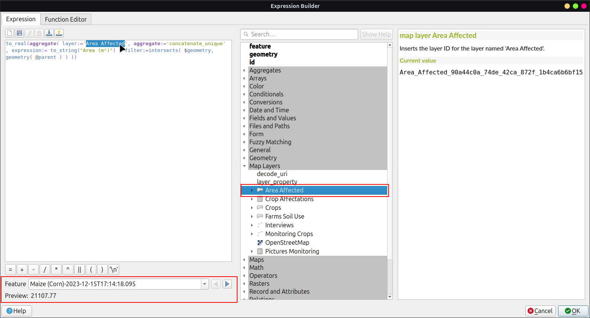

## Additional Variables

Read the [GNSS Positioning Documentation](../navigation-and-positioning/gnss.md) to store location details in attributes.

QFieldCloud provides three expression variables for attribute default values and conditional visibility:

- `@cloud_username`: Returns the username of the logged-in QFieldCloud account.
- `@cloud_useremail`: Returns the email address of the logged-in QFieldCloud account.
- `@cloud_teams`: Returns an array of strings representing the team(s) to which the user belongs within the context of the opened cloud project (e.g., `['surveyors', 'inspectors']`).

Examples of expression variables:

- Insert horizontal accuracy:
    ```sql
    @position_horizontal_accuracy
    ```
- Insert current timestamp:
    ```sql
    now()
    ```
- Insert digitized geometry length:
    ```sql
    length($geometry)
    ```
- Insert custom device variable:
    ```sql
    @operator_name
    ```
- Assign region codes based on spatial intersection:
    ```sql
    aggregate( layer:='regions', aggregate:='max', expression:="code", filter:=intersects( $geometry, geometry( @parent ) ) )
    ```
- Transform positioning coordinates to project CRS:
    ```sql
    x(transform(@position_coordinate, 'EPSG:4326', @project_crs))
    y(transform(@position_coordinate, 'EPSG:4326', @project_crs))
    ```
- Extract snapped feature attributes:
    ```sql
    with_variable(
      'first_snapped_point',
      array_first( @snapping_results ),
      attribute(
        get_feature_by_id(
          @first_snapped_point['layer'],
          @first_snapped_point['feature_id']
        ),
        'id'
      )
    )
    ```

## Define QML Widgets
:material-monitor: Project Manager

Integrate custom QML widgets to execute advanced form actions.

!!! Example
    A QML button widget for external map navigation:

    ```qml
    import QtQuick
    import QtQuick.Controls

    Button {
        width: 200
        height: width/5
        text: "Open in Maps"
        onClicked: {
            Qt.openUrlExternally(expression.evaluate("'geo:0,0?q=' || $y || ',' || $x"));
        }
    }
    ```

    The `geo` URI above is adapted to work with Android. For Apple Maps the URI can be changed to `'geo:' || $y || ',' || $x`.

    !
