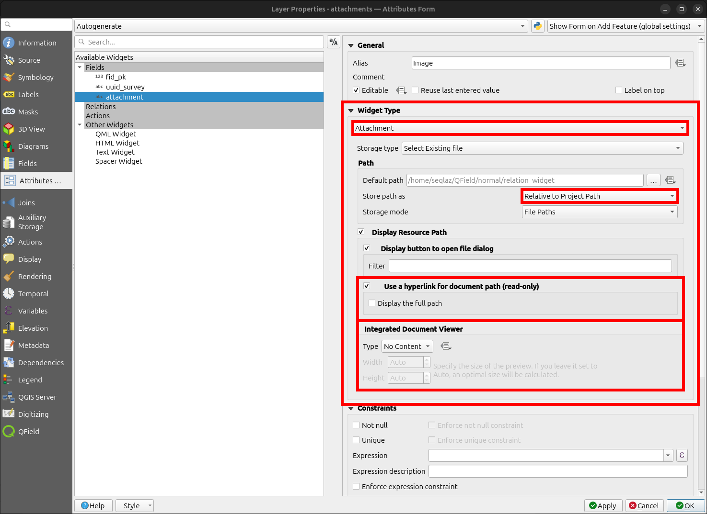
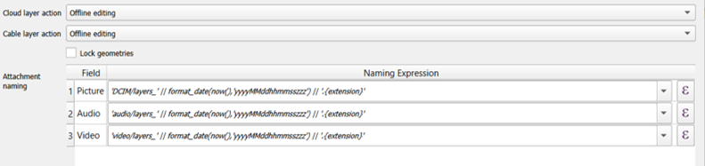
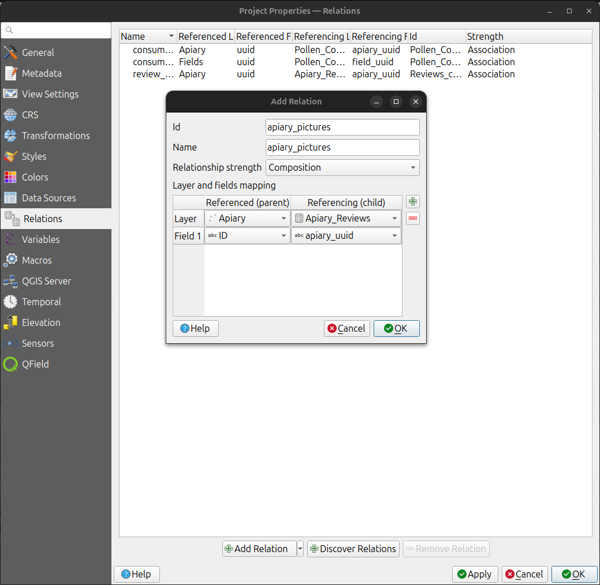
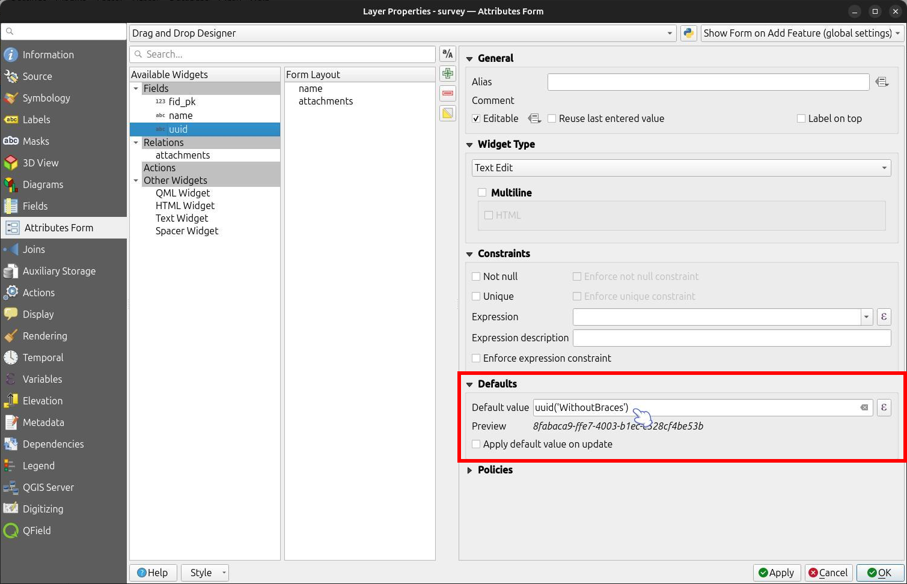
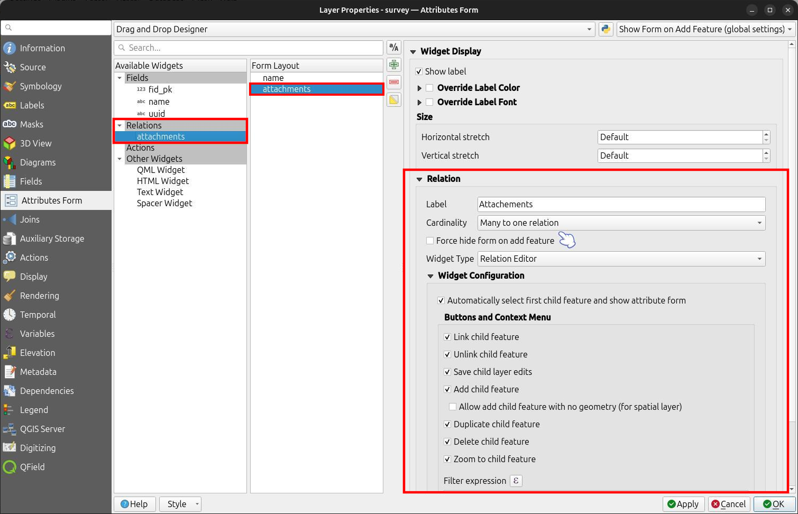
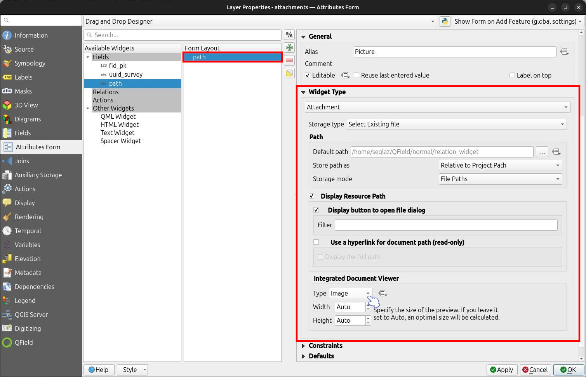
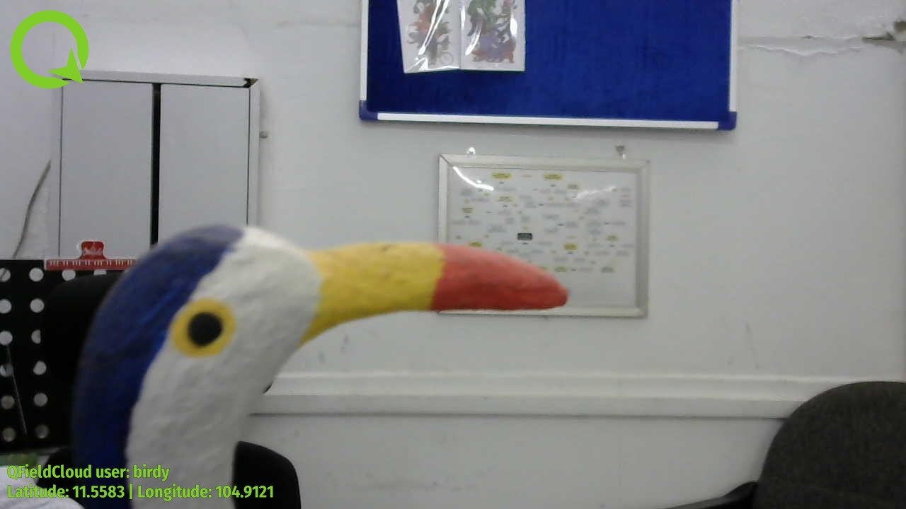

# Use Attachment

In QField, fields configured with the **Attachment** widget can:

- Display and capture photos.
- Display and record video clips.
- Listen to and record audio clips.
- Display links to external files like PDFs or documents.

!

## Widget configuration

In order for the attachments to be saved appropriately, it is necessary to keep a few things in mind.

!

- **Widget Type:** The widget type needs to be set to **Attachment**
- **Project Path:** The path needs to be set to **relative**.
The pictures, sound clips, videos, PDF's and documents are stored then in a sub-directory of the project, where the link stored in the text field is pointing to.
- **Synchronization Settings:** Attachments are generally stored in sub-directories of the project folder.
In the **QField Settings** of the project, these sub-directories also need to be copied.
The option **hyperlink** on the attachment widget will disable that functionality and show just the path to the file hyperlink to open the externally.
- Depending on what you have selected as **default**, one of them will be shown inside the form.
- By default when adding documents as attachments QField automatically displays the file name.
!

## Default Attachment name

As stated above, inside the attachment field, the actual attachment path is saved.
By default it will point to the project-specific **DCIM/Video/Audio** folders depending on the media type.

!!! Workflow

    1. Direct to the *Properties* > *QField* > *Attachments Settings*
    2. Use specific expressions to set the required names of the attachments.

    !

## Add a series of pictures to a feature

It is also possible to add more pictures to the feature either by having several attachment field attributes or by creating a relation to a separate table where the image paths are shown.
In this section we will show you an example how this is done.

### Setting up a relation

A relation to a second layer needs to be set in the QGIS properties so that when adding images or other formats, these are stored in the related table.

!!! Example

    You need two tables containing similar attributes as below.

    ***Parent:***

    | Field      | Type        |
    |------------|-------------|
    | `id`       | Text (UUID) |
    | `geometry` | Geometry    |
    | `...`      |             |

    ***Parent_pictures:***

    | Field       | Type       |
    |-------------|------------|
    | `id`        | Text (UUID)|
    | `parent_id` | Text (UUID)|
    | `path`      | Text       |
    | `...`       |            |


!!! Workflow
    1. Create two database tables in your data source using the schema structure below:

    2. Direct to *Project Properties* > *Relations*
    3. Click on the <span style="color:green">**:material-plus:**</span>
    4. Create a relation with:
        - **Referenced layer:** `Parent`
        - **Referenced field:** `id`
        - **Referencing layer:** `Parent_pictures`
        - **Referencing field:** `Parent_id`
        - **Composition:** `strength`
    !

### Attribute Form Configuration
:material-monitor: Project Manager

Configure attribute forms in feature layers after creating the layer relation.
Specify a default value in the `apiary` parent layer to generate unique primary keys.
Set the widget type to **Attachment** in the `apiary_picture` child layer.

!!! Workflow
    **Parent layer configuration:**

    1. Direct to *Layer Properties* > *Attribute Form*
    2. For the uuid field either choose the **Text Edit** or the *UUID Generator** widget.
    3. Set the default value to `uuid('WithoutBraces')`.
    4. Hide it from the view as it should not be edited by the user.
    !
    5. Under the **Relations* section of your attribute form, the relation to the layer with the photos should be visible.
    Set the relation widget to **many to one relation** and add the relation to the form layout

!

!!! Workflow
    **Child layer configuration:**

    1. Direct to *Properties* > *Attribute Form*
    2. Set the widget type to *Attachment* on the field that will save the picture paths.
    3. Add it to the form layout.
    4. Click **Apply**
    !

## Drawing Templates

QField includes built-in drawing and sketching tools to annotate captured images, draw on blank canvases, or sketch over templates.


### Drawing templates

On top of annotating captured images, QField supports drawing from image templates.
The following two methods are available to add templates:

- **Drawing Templates Folder on Desktop**: You can create a folder (`drawing_templates`) within your project folder and populate it with images.
Whenever that project is loaded, QField will register all images within that folder as drawing templates.
- **Drawing Templates folder on mobile:** On your mobile device within your QField directory you will find a folder named `drawing_templates`.
You can copy images directly into this folder and they will act as templates in all projects.

## Image Stamping

You can add image stamps to your pictures.
This includes, for instance, the date, the location, the title or other desired information.

!!! Workflow

    1. Navigate to the *Project* > *Properties* > *QField*
    2 Switch to the third tab at the top of the window **Attachments and Directories**
    2. Click on **Settings** next to **Customize image stamping details**.

!

You can add the following options:

- **Font and Alignment**: You have full control over the appearance of the stamped text, including the font style (color, size, drop shadow) and horizontal alignment (left, center, or right).

- **Image Decoration**: Add a custom image overlay, such as a logo or a watermark, on top of the captured image.

- **Force Stamping**: This option enforces image stamping, ensuring that all images collected for the project have the required information overlaid, regardless of the individual QField app settings.

- **Stamp Details**: Craft a multiline string using QGIS expressions to define the information stamped on the image.
A default template is provided to get you started, which includes common variables like date, time, and GNSS information.

!!! Example

    ***Default Template***:

    ```sql
    [% format_date(now(), 'yyyy-MM-dd @ HH:mm') %]
    Latitude [% coalesce(format_number(y(@gnss_coordinate), 7), 'N/A') %] | Longitude [% coalesce(format_number(x(@gnss_coordinate), 7), 'N/A') %] | Altitude [% coalesce(format_number(z(@gnss_coordinate), 3) || ' m', 'N/A') %]
    Speed [% if(@gnss_ground_speed != 'nan', format_number(@gnss_ground_speed, 3) || ' m/s', 'N/A') %] | Orientation [% if(@gnss_orientation != 'nan', format_number(@gnss_orientation, 1) || ' °', 'N/A') %]
    ```
    !
    !

## Fetching Geotags (EXIF) from the image file into the attribute table

Store EXIF geotag parameters (such as latitude, longitude, and camera orientation) directly inside vector attribute fields.

!!! Workflow

    1. Add an attribute per EXIF tag in the table that contains the pictures.
    2. Direct to *Layer Properties* > *Attribute Form*
    3. Find the field corresponding to your attachment
    4. Add the desired [QGIS EXIF function](https://docs.qgis.org/latest/en/docs/user_manual/expressions/functions_list.html#exif), <!-- markdown-link-check-disable-line -->
    and enable the **Apply on update**.
    3. The EXIF tags that QField can capture are listed in the QGIS documentation (link above).
    **Note:** This list might slightly vary depending on the mobile characteristics.
    4. Capturing EXIF tags requires accessing the full physical path of the picture.
    Be sure to reflect this in the QGIS expression.
    For example, the expression `exif(@project_folder + '/' + "path", 'Exif.Image.Orientation')` retrieves the orientation of the picture stored in *path*.
    For more tags visit the [QField EXIF reference documentation](../../reference/exif.md) and the [exiv library documentation](https://exiv2.org/tags.html).
    5. Completed! QField now captures and stores the EXIF tags in the pictures table while taking pictures.

## Maximum picture size

You can set the maximum picture size to save space.

!!! Workflow

    1. *Project* > *Properties* > *QField*
    2. Change to the third tab at the top of the window **Attachments and Directories**
    3. Set the maximum size
    !

## Attachment and Data Directories

If you have additional folders within your project folder that should be uploaded to QFieldCloud, you have to add them accordingly.
All paths are relative to the project directory.

!!! Workflow

    1. *Project* > *Properties* > *QField*
    2. Change to the third tab at the top of the window **Attachments and Directories**
    3. Choose between **Attachments** or **Data**
    !
