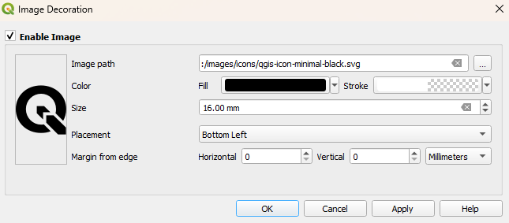

# Map Decorations

You can add **Map Decorations** to your map permanently, depending on your requirements.
More details you can find in the corresponding [QGIS documentation](https://docs.qgis.org/latest/en/docs/user_manual/map_views/map_view.html#decorating-the-map) <!-- markdown-link-check-disable-line -->

Choose from several decoration types:

- **Grid:** Overlays the map canvas with lines or markers at defined intervals to provide spatial reference, which is useful in remote areas.
- **Title Label:** Displays a title on your map, such as the project name.
- **Copyright Label:** Displays data source origins or branding information on your map canvas.
- **Image:** Places a logo, watermark, or graphic directly on your map.
- **Scale Bar:** Displays a scale bar on the map canvas, which can be enabled directly inside QField settings.

### Grid
:material-monitor: Project Manager

!!! Workflow
    1. In QGIS, navigate to *View* > *Decorations* > *Grid…*.
    !
    2. Check the **Enable Grid** box to activate it.
    3. Customize the grid's appearance:
    - **Grid type:** Choose between **Solid lines**, **Crosses**, or **Markers**.
    - **Interval:** Set the spacing for the grid lines on both the **X** and **Y** axes.
    The units are based on the project's Coordinate Reference System (CRS).
    - **Line/Marker Symbol:** Customize the color, thickness and style of the grid lines or markers to match your map style.
    - **Draw annotations:** If enabled, this will display the grid coordinates on the map.
    !
    You can control the font, direction, and distance of the annotations from the map frame.

Once configured in QGIS, the grid displays automatically in QField after synchronizing or transferring the project.

### Title Label
:material-monitor: Project Manager

!!! Workflow
    1. In QGIS, go to *View* > *Decorations* > *Title Label...*.
    !
    2. Check the **Enable Title Label** box.
    3. You can input static text or, for more powerful results, use a QGIS expression.
    With expressions your title can dynamically change.
    4. Click **Insert or Edit an Expression...** to open the expression builder.
    !

!!! Example

    A common use case is to display the project's title, which is set in the *Project* > *Properties...* > *General* tab.

    ```sql
    -- Displays the title saved in the project properties
    [% @project_title %]
    ```

    **Example of a more complex title:**

    You can combine static text with variables and functions to create a more detailed title.

    ```sql
    -- Creates a title like: "Survey for Project *' %project_name% - 20xx"
    'Survey for Project ' || [% @project_title %] || ' - ' || [% year(now()) %]
    ```

### Copyright Label
:material-monitor: Project Manager

!!! Workflow
    1. In QGIS, select *View* > *Decorations* > *Copyright Label…*.
    !
    2. Check the **Enable Copyright Label** box.
    3. Like the Title Label, this decoration fully supports QGIS expressions.

    The ability to use [positioning variables](../../reference/expression_variables.md#positioning-and-gnss-variables) (`@gnss_coordinate`) offers a streamlined way to display critical location data without cluttering the main user interface.

!!! Example

    **Continuous display of your real-time GPS information**

    ```sql
    -- Displays the GNSS coordinates and current map scale
    Lat: [% format_number(y(@gnss_coordinate), 8) %] | Lon: [% format_number(x(@gnss_coordinate), 8) %]
    Scale: 1:[% round(@map_scale) %]
    ```

### Image
:material-monitor: Project Manager

!!! Workflow
    1. In QGIS, open *View* > *Decorations* > *Image…*.
    !
    2. Check the **Enable Image** box.
    3. Select your image.

    **Note:** For the image to be shown in QField, you need to add the image to your project folder and set your path as relative path.

    - Create a dedicated folder inside your project directory (e.g., `assets`).
    - Reference the image using a path that starts with `./`.

This is how the map decorations look in QField


